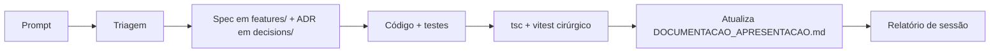

# 🧭 ESTRUTURA_AGENT — Colinha do Desenvolvedor

| Pasta/Arquivo | O que fica |
|:---|:---|
| `AGENTS.md` (raiz) | Ponto de entrada do agente com restrições críticas |
| `.agents/INICIALIZACAO.md` | Índice mestre, comandos, tabela de features |
| `.agents/rules/` | Políticas (`always_on`) |
| `.agents/features/` | Spec por feature (`kebab-case.md`) |
| `.agents/decisions/` | ADRs (`adr-001-nome.md`) — imutáveis após aprovadas |
| `.agents/troubleshooting/` | Resolução de erros |
| `.docs/` | Planejamento + documentação de apresentação (**versionada no Git** para sincronia da dupla) |
| `relatorios/<mes-ano>/` | Relatórios de sessão e handoff (**versionada no Git** para sincronia da dupla) |

## Fluxo

## Replicar em outro projeto
Pedir ao agente: *"inicialize o .agents"* (skill `bootstrap-agent-workspace`). Nomes em `kebab-case`.
Hierarquia de autoridade: `AGENTS.md > rules/ > INICIALIZACAO.md > README.md`.
