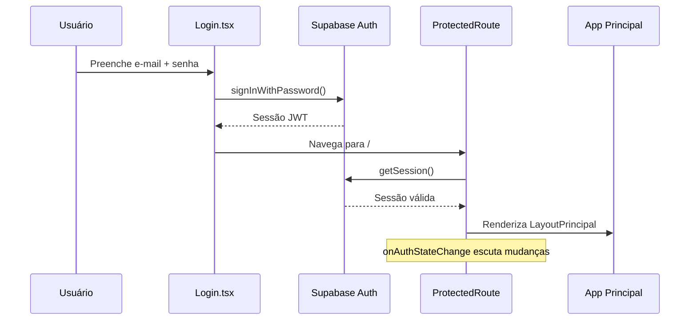
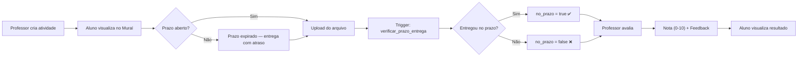
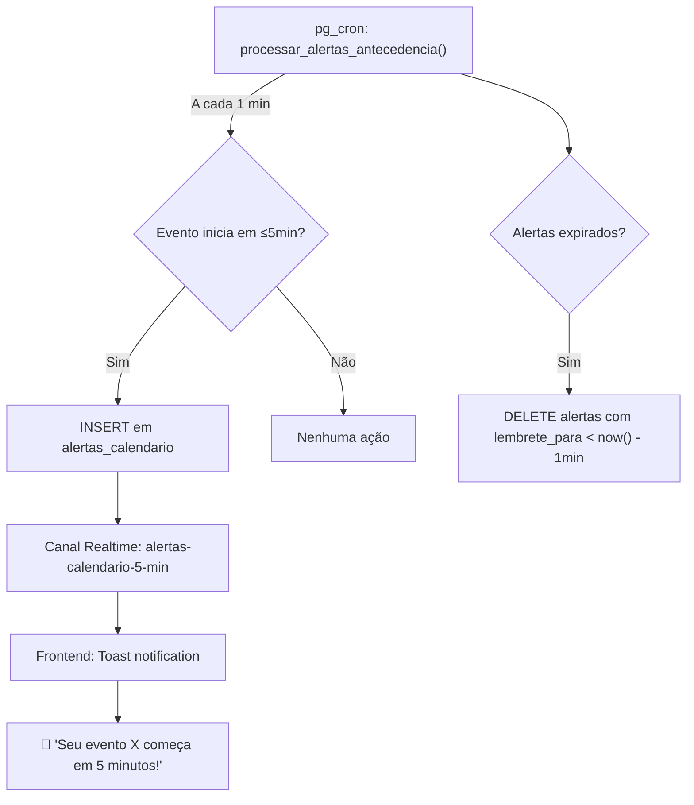
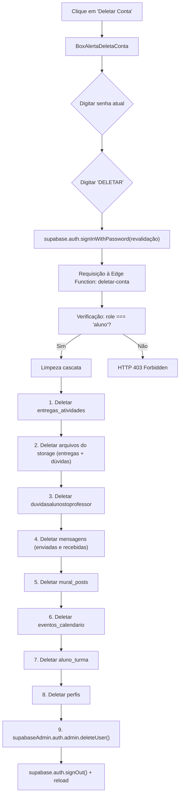
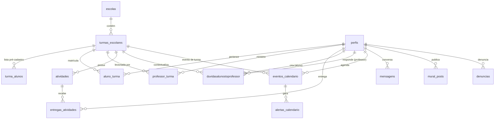
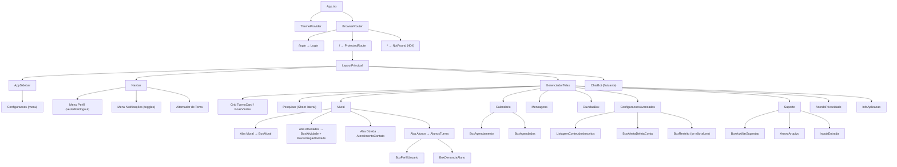

# NexusClass — Mapa Completo de Funcionalidades

Documentação técnica e funcional exaustiva de todos os módulos, recursos e comportamentos implementados na plataforma educacional NexusClass.

---

## 📑 Índice

- [1. Papéis de Usuário e Permissões](#1--papéis-de-usuário-e-permissões)
- [2. Autenticação e Segurança de Sessão](#2--autenticação-e-segurança-de-sessão)
- [3. Layout Principal e Navegação](#3--layout-principal-e-navegação)
- [4. Painel de Turmas (Tela Inicial)](#4--painel-de-turmas-tela-inicial)
- [5. Pesquisa, Matrícula e Inscrição](#5--pesquisa-matrícula-e-inscrição)
- [6. Mural da Turma](#6--mural-da-turma)
- [7. Central de Atividades e Avaliação](#7--central-de-atividades-e-avaliação)
- [8. Canal de Dúvidas (Aluno ↔ Professor)](#8--canal-de-dúvidas-aluno--professor)
- [9. Mensagens Privadas em Tempo Real](#9--mensagens-privadas-em-tempo-real)
- [10. Calendário Acadêmico e Alertas](#10--calendário-acadêmico-e-alertas)
- [11. Assistente Virtual IA — Tigreso & Falcão](#11--assistente-virtual-ia--tigreso--falcão)
- [12. Perfis de Usuário](#12--perfis-de-usuário)
- [13. Notificações e Preferências](#13--notificações-e-preferências)
- [14. Configurações Avançadas e Zona de Perigo](#14--configurações-avançadas-e-zona-de-perigo)
- [15. Central de Suporte Técnico](#15--central-de-suporte-técnico)
- [16. Acordo de Privacidade (LGPD)](#16--acordo-de-privacidade-lgpd)
- [17. Página Sobre / Informações do Projeto](#17--página-sobre--informações-do-projeto)
- [18. Sistema de Denúncias](#18--sistema-de-denúncias)
- [19. Tema Visual (Claro / Escuro / Sistema)](#19--tema-visual-claro--escuro--sistema)
- [20. Responsividade e Mobile](#20--responsividade-e-mobile)
- [21. Banco de Dados — Esquema Completo](#21--banco-de-dados--esquema-completo)
- [22. Segurança em Camadas (RLS)](#22--segurança-em-camadas-rls)
- [23. Automação Backend (Triggers, Cron Jobs, Edge Functions)](#23--automação-backend-triggers-cron-jobs-edge-functions)
- [24. Realtime — Canais em Tempo Real](#24--realtime--canais-em-tempo-real)
- [25. Scripts de Automação e Testes](#25--scripts-de-automação-e-testes)
- [26. Funções Utilitárias](#26--funções-utilitárias)
- [27. Árvore de Componentes](#27--árvore-de-componentes)

---

## 1. 👥 Papéis de Usuário e Permissões

A plataforma opera com **três papéis** hierárquicos, cada qual com escopo de ações bem delimitado:

| Papel | Descrição | Permissões-Chave |
|:---:|:---|:---|
| **Aluno** | Estudante matriculado em uma ou mais turmas | Inscrever-se/sair de turmas, enviar atividades, postar no mural, criar dúvidas, agendar eventos pessoais, usar o chatbot, excluir própria conta |
| **Professor** | Docente vinculado a turmas específicas | Publicar atividades e avaliá-las (notas + feedback), responder dúvidas, criar eventos de turma, postar no mural, excluir conteúdos do mural |
| **Master** | Administrador com visão e controle global | Todas as permissões anteriores + gerenciamento de escolas/turmas/alunos, visualização global de dúvidas, exclusão de qualquer conteúdo, acesso irrestrito a todas as turmas |

> [!NOTE]
> As permissões são aplicadas em **duas camadas**: no frontend (renderização condicional) e no backend (políticas RLS do PostgreSQL), impedindo qualquer burla via manipulação de requisições.

---

## 2. 🔐 Autenticação e Segurança de Sessão

### Funcionalidades Implementadas

| Funcionalidade | Detalhes |
|:---|:---|
| **Login com e-mail e senha** | Autenticação via `supabase.auth.signInWithPassword` |
| **Cadastro de nova conta** | Via `supabase.auth.signUp` com nome capitalizado automaticamente |
| **Persistência de sessão** | Token JWT restaurado automaticamente ao recarregar a página via `supabase.auth.getSession()` |
| **Escuta de estado em tempo real** | Listener `onAuthStateChange` monitora `SIGNED_IN`, `SIGNED_OUT`, `TOKEN_REFRESHED` e troca de usuário |
| **Rota protegida (Route Guard)** | Componente `ProtectedRoute` redireciona para `/login` caso não haja sessão válida; exibe spinner durante verificação |
| **Alternância senha visível/oculta** | Botão olho aberto/fechado nos campos de senha |
| **Tradução de erros** | Mensagens de erro da API traduzidas para português (ex: `"Invalid login credentials"` → `"E-mail ou senha incorretos!"`) |
| **Injeção de contexto** | Sessão, perfil, matérias do professor e método de atualização injetados via `<Outlet context={...} />` do React Router |

### Fluxo

---

## 3. 🧭 Layout Principal e Navegação

A aplicação opera como uma **Single Page Application (SPA)** com um dashboard centralizado, sem recarregamento de página nas transições.

### Estrutura do Layout

| Elemento | Componente | Descrição |
|:---|:---|:---|
| **Barra lateral (Sidebar)** | `AppSidebar.tsx` | Menu retrátil com itens: Início, Pesquisar, Mensagens, Calendário, Dúvidas, lista de turmas inscritas e configurações. Badges numéricos para mensagens não lidas e dúvidas pendentes. |
| **Barra superior (Navbar)** | `Navbar.tsx` | Avatar do usuário, menu de notificações com toggles, alternador de tema (claro/escuro/sistema), menu do perfil (visualizar, editar, logout) |
| **Área central (Conteúdo)** | `GerenciadorTelas.tsx` | Renderiza dinamicamente a tela ativa conforme o estado `acessouOq` |
| **Chatbot flutuante** | `ChatBot.tsx` | Botão circular fixo no canto inferior direito com janela de conversa expansível |

### Telas Disponíveis

| Identificador | Tela Renderizada | Descrição |
|:---|:---|:---|
| `"principal"` | Grid de `TurmaCard` ou `BoasVindas` | Painel inicial com turmas do usuário |
| `"pesquisar"` | `Pesquisar` | Busca e matrícula em turmas |
| `"mural"` | `Mural` | Sala de aula virtual com abas |
| `"calendario"` | `Calendario` | Calendário mensal interativo |
| `"mensagens"` | `Mensagens` | Chat privado 1-a-1 |
| `"duvidas"` | `DuvidasBox` | Central de dúvidas acadêmicas |
| `"configuracoesAvancadas"` | `ConfiguracoesAvancadas` | Gestão de conta e matrículas |
| `"suporte"` | `Suporte` | Abertura de chamados técnicos |
| `"privacidade"` | `AcordoPrivacidade` | Termos de uso e LGPD |
| `"info"` | `InfoAplicacao` | Sobre o projeto e a equipe |

### Roteamento Global (React Router v6)

| Rota | Componente | Proteção |
|:---|:---|:---|
| `/login` | `Login` | Pública |
| `/` | `LayoutPrincipal` | Protegida (`ProtectedRoute`) |
| `*` | `NotFound` (404) | Pública |

---

## 4. 🏫 Painel de Turmas (Tela Inicial)

### Para Alunos com Turmas Inscritas
- **Grid responsivo** de cartões (`TurmaCard`) exibindo cada turma matriculada
- Cada card mostra: banner da matéria, nome da disciplina, sala, avatar e nome do professor
- Botão **"Entrar"** para acessar o mural da turma

### Para Alunos sem Turmas (Primeiro Acesso)
- Tela **"Boas-Vindas"** (`BoasVindas`) com:
  - Saudação personalizada com nome do usuário
  - Destaque dos recursos da plataforma (turmas, IA, atividades)
  - Botão **"Explorar Novas Turmas"** que redireciona para a busca

### Para Professores
- Exibição das **turmas que leciona** (vinculadas pela tabela `professor_turma`)
- Mensagem personalizada sobre alocação de disciplinas pela coordenação

### Para Masters
- **Visão global** de todas as turmas cadastradas na escola
- Acesso irrestrito ao mural de qualquer turma

### Carregamento de Dados Escolares
O hook `useEscolaDados` realiza 4 consultas sequenciais para montar a árvore completa:
1. `escolas` → dados da instituição (nome e ano letivo)
2. `turmas_escolares` → turmas vinculadas à escola
3. `professor_turma` + `perfis` → professor responsável de cada turma com foto
4. `aluno_turma` + `perfis` → alunos matriculados em cada turma com foto

---

## 5. 🔍 Pesquisa, Matrícula e Inscrição

### Interface
- **Painel lateral deslizante** (Sheet/Drawer) acessível pela sidebar
- **Campo de busca textual** em tempo real, pesquisando simultaneamente por: matéria, professor, sala e código da turma (case-insensitive)
- **Abas exclusivas para alunos**: *Inscritas*, *Disponíveis* e *Todas*

### Matrícula e Desinscrição
| Ação | Fluxo |
|:---|:---|
| **Inscrever-se** | Clique em "Inscrever-se" → modal de confirmação → `INSERT` em `aluno_turma` → atualização otimista do estado |
| **Cancelar inscrição** | Disponível em Configurações Avançadas → `ListagemConteudosInscritos` → confirmação com alerta → `DELETE` em `aluno_turma` → toast de confirmação |

### Regras de Negócio
- Professores visualizam apenas suas turmas; não podem se inscrever
- Masters acessam todas as turmas automaticamente sem necessidade de inscrição
- Resultados priorizados: turmas já inscritas aparecem primeiro
- Alternância otimista do estado com rollback caso a requisição falhe

---

## 6. 📋 Mural da Turma

O mural é a **sala de aula virtual** do NexusClass, acessada ao entrar em uma turma. Opera com 4 abas internas:

### 6.1 Aba "Mural" — Feed de Avisos e Posts

| Funcionalidade | Papel | Detalhes |
|:---|:---|:---|
| **Publicar no mural** | Professor / Master | Botão "Postar no mural" → modal `BoxMural` com campo de texto → `INSERT` em `mural_posts` |
| **Visualizar posts** | Todos | Cartões cronológicos com nome do autor, avatar, data e conteúdo |
| **Ver perfil do autor** | Todos | Menu de contexto no post → abre `BoxPerfilUsuario` |
| **Enviar mensagem ao autor** | Todos | Menu de contexto → redireciona para o chat privado |
| **Excluir post** | Autor ou Master | Menu de contexto → `DELETE` em `mural_posts` |
| **Notificação realtime** | Todos | Ao receber novo post de outro usuário, exibe toast automático (canal `realtime:mural_posts`) |

### 6.2 Aba "Atividades" — Tarefas e Avaliações

| Funcionalidade | Papel | Detalhes |
|:---|:---|:---|
| **Criar atividade** | Professor / Master | Botão "Postar Atividade" → modal `BoxAtividade` com título, enunciado, data/hora limite e upload de múltiplos anexos de apoio |
| **Editar atividade** | Professor / Master | Botão de edição → reabre `BoxAtividade` com campos preenchidos; permite alterar título, prazo e anexos (com exclusão seletiva de arquivos antigos) |
| **Excluir atividade** | Professor / Master | Cascata: remove arquivos de submissões (bucket `entregas_atividades`) + anexos do professor (bucket `anexos_atividades`) + registro do banco |
| **Visualizar atividade** | Todos | Card com data de postagem, prazo de entrega, status de pontualidade e links para download dos anexos |
| **Enviar tarefa (entrega)** | Aluno | Gaveta expansível `BoxEntregaAtividade` → upload de arquivo → `UPSERT` em `entregas_atividades` → armazenado no bucket privado `entregas_atividades/{atividade_id}/{aluno_id}/{arquivo}` |
| **Reenviar tarefa** | Aluno | Substituição do arquivo anterior caso ainda não tenha sido avaliado |
| **Verificar pontualidade** | Automático (Backend) | Trigger `verificar_prazo_entrega()` compara `entregue_em` com `data_entrega` da atividade e calcula `no_prazo` no servidor, impedindo fraude de horário no frontend |
| **Avaliar entregas** | Professor / Master | Listagem de todos os alunos que entregaram → download do arquivo → formulário inline para nota (0.00 a 10.00) e feedback textual |
| **Visualizar nota/feedback** | Aluno | Após avaliação, exibe nota numérica e parecer do professor |
| **Notificação realtime** | Todos | Toasts ao publicar nova atividade (canal `realtime:atividades`) ou ao enviar entrega (canal `realtime:entregas-mural`) |

### 6.3 Aba "Enviar Dúvida" (Apenas Alunos)

- Modal `AtendimentoContato` com:
  - Campo de assunto
  - Campo de mensagem detalhada
  - Upload de múltiplos anexos (bucket `duvidasalunostoprofessor`)
  - Enviado diretamente ao professor regente da turma

### 6.4 Aba "Alunos" — Participantes da Turma

- Seção **Professor**: avatar, nome e matéria
- Seção **Estudantes**: contagem total + tabela com:
  - Avatar e nome de cada aluno (excluindo o próprio usuário)
  - Menu de ações (3 pontos): Ver Perfil, Enviar Mensagem, Denunciar

---

## 7. 📝 Central de Atividades e Avaliação

### Fluxo Completo — Perspectiva do Aluno

### Regras de Armazenamento
- **Bucket `entregas_atividades`**: Privado, caminho padronizado `{atividade_id}/{aluno_id}/{arquivo}`
- **Bucket `anexos_atividades`**: Armazena os materiais de apoio publicados pelo professor
- **Download**: Via URLs assinadas (signed URLs) com validade de **1 hora**
- **Higienização de nomes**: Caracteres especiais substituídos por `_` antes do upload

---

## 8. ❓ Canal de Dúvidas (Aluno ↔ Professor)

### Funcionalidades

| Funcionalidade | Papel | Detalhes |
|:---|:---|:---|
| **Enviar dúvida** | Aluno | Formulário com assunto, descrição e múltiplos anexos → `INSERT` em `duvidasalunostoprofessor` |
| **Listar dúvidas** | Todos | Filtros: *Todos*, *Pendente* (vermelho), *Resolvida* (verde) |
| **Visualizar dúvida** | Aluno (própria), Professor (recebida), Master (todas) | Card com remetente, matéria, data, assunto, corpo, links de anexos e bloco de resposta |
| **Responder dúvida** | Professor / Master | Botão "Responder Dúvida" → modal de texto → `UPDATE` com `resposta` + `resolvido = true` |
| **Editar resposta** | Professor / Master | Reabrir e alterar resposta anterior |
| **Excluir dúvida** | Aluno (autor), Professor (destinatário), Master | Trigger `deletar_anexos_duvida` limpa automaticamente os arquivos do storage antes do `DELETE` |
| **Contagem na sidebar** | Todos | Badge numérico indicando dúvidas em aberto (aluno: suas pendentes; professor: recebidas; master: todas) |

### Manutenção Automática
- **Cron Job mensal** (`deletar-duvidas-resolvidas-mensal`): Todo dia **1º** à meia-noite, exclui automaticamente dúvidas marcadas como resolvidas, acionando em cadeia a trigger de limpeza de anexos do storage.

---

## 9. 💬 Mensagens Privadas em Tempo Real

### Funcionalidades

| Funcionalidade | Detalhes |
|:---|:---|
| **Envio de mensagens** | Chat 1-a-1 entre qualquer par de usuários (aluno-professor, aluno-aluno, etc.) |
| **Recebimento instantâneo** | Via canal Realtime `chat-nexusclass` escutando `INSERT` e `UPDATE` na tabela `mensagens` |
| **Confirmação de leitura** | Atualiza `lida = true` tanto no banco de dados quanto no `localStorage`; `marcarComoLidas()` executado automaticamente ao abrir a conversa |
| **Barra lateral de conversas** | Lista cronológica de contatos recentes com avatar, nome, prévia da última mensagem, carimbo de data relativo e badge de não lidas |
| **Balões diferenciados** | Remetente (direita, cor de destaque) e destinatário (esquerda), com horários e separadores automáticos de dia ("Hoje", "Ontem", data) |
| **Excluir conversa** | Ocultação local via `localStorage` — remove da vista do usuário sem apagar do banco (o outro participante mantém o histórico) |
| **Rolagem automática** | Scroll suave para a mensagem mais recente via ref |
| **Bloqueio de vazios** | Mensagens compostas apenas de espaços são rejeitadas |
| **Layout mobile** | Botão de voltar para alternar entre lista de contatos e área de chat em smartphones |

### Agrupamento Inteligente de Conversas
O hook `useMensagens` gera automaticamente um `ConversaResumo` por contato, contendo:
- ID e nome do contato
- Última mensagem (texto + timestamp)
- Contagem de mensagens não lidas
- Ordenação cronológica descendente

---

## 10. 📅 Calendário Acadêmico e Alertas

### Interface do Calendário

| Funcionalidade | Detalhes |
|:---|:---|
| **Visualização mensal** | Componente `Calendario` com navegação entre meses e seleção de dias |
| **Marcadores visuais por cor** | Dias com eventos pessoais (roxo/violeta), eventos de turma (cor da matéria), ou mistos (gradiente) |
| **Legenda** | Rodapé com explicação das cores utilizadas |
| **Painel lateral** | Ao selecionar um dia: formulário de agendamento (`BoxAgendamento`) + listagem do dia (`BoxAgendados`) |
| **Atalhos rápidos** | Botões: "Hoje", "Amanhã", "Em 3 dias", "Em 1 semana", "Em 2 semanas" |

### Agendamento de Eventos

| Tipo | Quem pode criar | Quem pode ver | Quem pode excluir |
|:---|:---|:---|:---|
| **Pessoal** | Todos | Apenas o autor | Apenas o autor |
| **Turma** | Professor / Master | Autor + alunos da turma + professores da turma + master | Autor, professor da turma ou master |

### Formulário de Agendamento
- Título (obrigatório)
- Tipo: Pessoal ou Turma (turma só para professor/master)
- Seletor de turma (quando tipo = turma)
- Horário: menus separados para hora (00-23) e minuto (00-59)
- Descrição (opcional)

### Regras de Negócio
- Agendamento bloqueado em datas passadas (`comparaDataHj`)
- Alunos são forçados a criar eventos como tipo `"pessoal"` (constraint no banco e no frontend)
- Eventos expirados são filtrados a cada 30 segundos e removidos pelo cron `remover-eventos-calendario-expirados`

### Sistema de Alertas em Tempo Real

- **Alertas de 5 minutos** e **1 minuto** antes do início do evento
- **Deduplicação**: Set em memória (`alertasEnviadosRef`) impede que o mesmo alerta dispare mais de uma vez
- **Verificação local complementar**: A cada 30 segundos, o frontend avalia localmente se há eventos iminentes do usuário
- **Unique constraint** no banco: `(evento_id, minutos_antes)` impede alertas duplicados

---

## 11. 🤖 Assistente Virtual IA — Tigreso & Falcão

### Dois Modos de Operação

| Assistente | Contexto | Ativação |
|:---|:---|:---|
| **Tigreso** 🐯 | Tutor acadêmico — responde sobre matérias, atividades pendentes, eventos do calendário, posts do mural e dúvidas | Botão flutuante no canto inferior direito |
| **Falcão Peregrino** 🦅 | Especialista em termos de uso, privacidade, LGPD e segurança da plataforma | Ativado ao clicar "Dúvidas sobre os termos de uso" na página de privacidade |

### Tecnologia
- **Modelo**: Google Gemini (`gemini-3.1-flash-lite-preview`) via SDK `@google/generative-ai`
- **Function Calling**: A IA pode consultar dados reais do Supabase em tempo de execução

### Functions disponíveis para a IA

| Função | O que consulta | Tabela(s) |
|:---|:---|:---|
| `obterPostsProfessor` | Posts recentes de professores e masters no mural das turmas | `mural_posts` + `perfis` |
| `obterDuvidas` | Dúvidas do aluno ou recebidas pelo professor com status e respostas | `duvidasalunostoprofessor` |
| `obterResumoEventos` | Até 10 próximos eventos do calendário | `eventos_calendario` |
| `obterAtividadesAbertas` | Atividades pendentes (aluno: não entregues; professor: todas criadas) | `atividades` + `entregas_atividades` |

### Exemplos de Perguntas que a IA Responde
- *"Quais atividades tenho pendentes?"*
- *"O que tenho agendado no calendário esta semana?"*
- *"O que o professor postou recentemente no mural?"*
- *"Qual o status da minha dúvida enviada?"*
- *"Posso excluir minha conta?"*
- *"Quais dados a plataforma coleta sobre mim?"*

### Proteções e Resiliência
- **Proibição de vazamento de prompt**: Instrução estrita impedindo revelação das regras internas
- **Escopo restrito**: Tigreso recusa responder temas fora do ambiente escolar; Falcão responde apenas sobre termos e privacidade
- **Retry com backoff exponencial**: Em caso de erro HTTP 503 (Gemini sobrecarregado), tenta novamente com delays crescentes
- **Contexto personalizado**: A IA recebe o perfil do usuário, turmas e matérias para respostas contextualizadas

### Interface do Chatbot
- Botão circular flutuante com ícone de robô
- Janela de conversa com avatar do bot e status *"Online Agora"*
- Histórico de mensagens com balões visuais diferenciados
- Efeito de digitação com bolinhas pulsantes durante carregamento
- Envio via Enter ou botão
- Oculta-se automaticamente em certas telas para evitar sobreposição
- Expõe método `abrirComAjuda()` via `useImperativeHandle` para abertura programática

---

## 12. 👤 Perfis de Usuário

### Visualização de Perfil Próprio (Navbar)
- Modal com avatar ampliado, nome, cargo/role, e-mail e biografia

### Edição de Perfil (Navbar)
- Atualização da URL de foto do perfil
- Edição do texto de biografia
- Nome e e-mail protegidos (somente leitura)
- Persistência via `UPDATE` em `perfis` no Supabase + sincronização do estado global

### Visualização de Perfil de Terceiros
- Acessível de qualquer ponto onde aparece o nome de um usuário (mural, alunos, mensagens)
- Modal `BoxPerfilUsuario` com: banner decorativo, avatar, nome, badge do papel, data de cadastro, e-mail e biografia
- Consulta via `supabase.from("perfis").select(...).eq("nome", nomeUsuario)`
- Indicação de "Você" caso o perfil seja o do próprio usuário logado

### Avatar Inteligente (`PerfilAvatar`)
- Exibe a foto do perfil quando disponível
- Gera automaticamente avatar circular com a inicial do nome quando não há foto
- Cor de fundo determinística por hashing do nome (consistente em toda a aplicação)

---

## 13. 🔔 Notificações e Preferências

### Tipos de Notificação

| Tipo | Mecanismo | Visualização |
|:---|:---|:---|
| **Mensagens não lidas** | Badge numérico na sidebar e na navbar | Número total de mensagens não lidas de todos os contatos |
| **Dúvidas pendentes** | Badge numérico na sidebar | Contagem conforme papel (aluno: suas; professor: recebidas; master: todas) |
| **Alertas de calendário** | Toast notification disparado por cron + Realtime | "Seu evento X começa em 5/1 minutos!" |
| **Novos posts no mural** | Toast notification via canal Realtime | "Novo post de [Professor] na turma [Matéria]" |
| **Nova atividade publicada** | Toast notification via canal Realtime | "Nova atividade publicada" |
| **Entrega de atividade** | Atualização automática via Realtime | Lista de entregas atualizada em tempo real |

### Configuração de Preferências
- Menu na Navbar com **toggles** (checkboxes) para habilitar/desabilitar:
  - Indicadores de Mensagens
  - Indicadores de Dúvidas
- Preferências salvas no `localStorage` por ID de usuário: `nexusclass:indicadores-notificacao:<userId>`
- Padrão: ambos ativados

---

## 14. ⚙️ Configurações Avançadas e Zona de Perigo

> [!IMPORTANT]
> O acesso a esta tela é **restrito a alunos**. Professores e Masters recebem a tela `BoxRestrito` com ícone de cadeado animado e mensagem de acesso negado.

### Funcionalidades

| Funcionalidade | Detalhes |
|:---|:---|
| **Dados da conta** | Exibição de nome e e-mail cadastrados (somente leitura) |
| **Redefinição de senha** | Input com botão de visibilidade → validação mínima de 6 caracteres → `supabase.auth.updateUser({ password })` |
| **Gerenciamento de inscrições** | Tabela `ListagemConteudosInscritos` com matéria, código, professor e botão "Sair da Turma" com confirmação |
| **Zona de Perigo — Exclusão de Conta** | Botão vermelho → abre `BoxAlertaDeletaConta` |

### Protocolo de Exclusão de Conta

---

## 15. 🆘 Central de Suporte Técnico

### Interface
- Formulário completo com campos dinâmicos:
  - Nome e e-mail (preenchidos automaticamente do perfil)
  - Assunto (dropdown com categorias: problemas no mural, perfil, atividades, chatbot, calendário, acesso, urgências)
  - Tela onde ocorreu o erro
  - Descrição detalhada
  - Upload de múltiplos arquivos/prints
- Painel lateral `BoxAuxiliarSugestao` com:
  - Canais de comunicação oficial (e-mail de retorno)
  - Dicas para acelerar diagnóstico (prints, mensagens de erro, passo a passo)

### Fluxo de Envio
1. Validação de campos obrigatórios
2. Upload de anexos no bucket `anexos_suporte` (nomes com timestamp aleatório)
3. `INSERT` em tabela `suporte` com status `'pendente'`
4. Toast de confirmação e limpeza do formulário

---

## 16. 📜 Acordo de Privacidade (LGPD)

- Documento completo com **14 cláusulas** cobrindo:
  - Aceitação dos termos e condições
  - Natureza simulada dos serviços (ambiente acadêmico/laboratório)
  - Segurança de contas e responsabilidade por credenciais
  - Conduta no mural e comunidade
  - Conteúdo gerado pelo usuário
  - Gratuidade e ausência de cobrança
  - Disponibilidade e SLA
  - Política de privacidade de dados pessoais
  - Direito à exclusão completa de dados
  - Suspensão e encerramento de contas
  - Legislação aplicável e foro
- Botão **"Dúvidas sobre os termos de uso"** que abre o ChatBot no modo Falcão Peregrino (assistente especializado em LGPD)

---

## 17. ℹ️ Página Sobre / Informações do Projeto

Tela rica de documentação acadêmica e institucional do NexusClass, incluindo:

| Seção | Conteúdo |
|:---|:---|
| **Hero** | Versão da aplicação, badges tecnológicas, métricas (+300 commits, +130h de dev) |
| **Origem** | Conexão com o projeto GET SI e mentoria do Prof. Igor Knop |
| **Metodologia** | Kanban, casos de uso, UML, ciclos de deploy |
| **Atores do Sistema** | Matriz detalhada (Aluno, Professor, Master) |
| **Arquitetura** | Diagrama multicamadas: Frontend SPA → Hooks → Supabase → IA/Email |
| **Funcionalidades** | Checklist de tudo implementado |
| **Tecnologias** | Cards detalhados de cada tecnologia utilizada |
| **Limitações** | Escopo declarado (sem diplomas, sem cobrança, dados fictícios) |
| **Equipe** | Cards dos desenvolvedores com links para GitHub |

---

## 18. 🚩 Sistema de Denúncias

- Acessível pela aba "Alunos" do mural → menu de contexto de cada colega
- Modal `BoxDenunciaAluno` com:
  - **Grade de motivos pré-definidos** (seleção com indicadores de checagem):
    - Bullying/Assédio
    - Conteúdo inapropriado
    - Spam/Propaganda
    - Comportamento ofensivo
    - Perfil falso
    - Problemas de segurança
    - Outro
  - Campo de detalhes adicionais (opcional; preenchido com texto padrão se vazio)
  - `INSERT` na tabela `denuncias` com status `'pendente'`
  - Feedback visual de sucesso ou erro

---

## 19. 🎨 Tema Visual (Claro / Escuro / Sistema)

- **Provedor global** `ThemeProvider` envolve toda a aplicação
- **Três opções**: Claro, Escuro, Automático (do sistema operacional)
- **Persistência** no `localStorage` sob chave `vite-ui-theme`
- **Sincronização com SO**: `window.matchMedia("(prefers-color-scheme: dark)")` com listener ativo quando modo = "system"
- **Alternância instantânea** sem recarregar a página, manipulando classes `light`/`dark` no `<html>`
- **Acesso**: Menu da Navbar com ícones de Sol e Lua

---

## 20. 📱 Responsividade e Mobile

- **Breakpoint**: 768px (`MOBILE_BREAKPOINT`)
- **Detecção**: Hook `useIsMobile` com `window.matchMedia` e listener ativo
- **Adaptações em mobile**:
  - Sidebar colapsa em menu hambúrguer com gaveta retrátil
  - Grid de turmas muda para coluna única
  - Mensagens alternam entre lista de contatos e área de chat
  - ChatBot oculta-se em certas telas para evitar sobreposição
  - Calendário reorganiza de 2 colunas para 1

---

## 21. 🗃️ Banco de Dados — Esquema Completo

### Diagrama ER

### Tabelas Detalhadas

<b>escolas</b>

| Coluna | Tipo | Restrições |
|:---|:---|:---|
| `id` | `uuid` | PK, `DEFAULT gen_random_uuid()` |
| `nome` | `text` | `NOT NULL` |
| `ano_letivo` | `integer` | `NOT NULL` |
| `created_at` | `timestamptz` | `NOT NULL DEFAULT now()` |

<b>turmas_escolares</b>

| Coluna | Tipo | Restrições |
|:---|:---|:---|
| `id` | `uuid` | PK |
| `escola_id` | `uuid` | FK → `escolas(id) ON DELETE CASCADE` |
| `chave` | `text` | `NOT NULL`, `UNIQUE(escola_id, chave)` |
| `materia` | `text` | `NOT NULL` |
| `professor` | `text` | `NOT NULL` |
| `banner_url` | `text` | `NOT NULL` |
| `foto_professor_url` | `text` | `NOT NULL` |
| `sala` | `text` | `NOT NULL` |
| `turma` | `text` | `NOT NULL` |
| `created_at` | `timestamptz` | `NOT NULL DEFAULT now()` |

<b>eventos_calendario</b>

| Coluna | Tipo | Restrições |
|:---|:---|:---|
| `id` | `uuid` | PK |
| `titulo` | `text` | `NOT NULL` |
| `descricao` | `text` | `NOT NULL DEFAULT ''` |
| `data` | `date` | `NOT NULL` |
| `horario` | `time` | Opcional |
| `autor_id` | `uuid` | FK → `perfis(id) ON DELETE CASCADE` |
| `tipo` | `text` | `NOT NULL DEFAULT 'pessoal'`, `CHECK IN ('pessoal', 'turma')` |
| `turma_id` | `uuid` | FK → `turmas_escolares(id)`, obrigatório se tipo = 'turma' |
| `created_at` | `timestamptz` | `NOT NULL DEFAULT now()` |

**Constraint de escopo**: `(tipo='pessoal' AND turma_id IS NULL) OR (tipo='turma' AND turma_id IS NOT NULL)`

<b>alertas_calendario</b>

| Coluna | Tipo | Restrições |
|:---|:---|:---|
| `id` | `uuid` | PK |
| `evento_id` | `uuid` | FK → `eventos_calendario(id) ON DELETE CASCADE` |
| `titulo_evento` | `text` | `NOT NULL` |
| `mensagem` | `text` | `NOT NULL` |
| `minutos_antes` | `integer` | `NOT NULL`, `CHECK IN (1, 5)`, `UNIQUE(evento_id, minutos_antes)` |
| `lembrete_para` | `timestamptz` | `NOT NULL` |
| `created_at` | `timestamptz` | `NOT NULL DEFAULT now()` |

<b>duvidasalunostoprofessor</b>

| Coluna | Tipo | Restrições |
|:---|:---|:---|
| `id` | `uuid` | PK |
| `aluno_id` | `uuid` | FK → `perfis(id) ON DELETE CASCADE` |
| `prof_id` | `uuid` | FK → `perfis(id) ON DELETE CASCADE` |
| `turma_id` | `uuid` | FK → `turmas_escolares(id) ON DELETE CASCADE` |
| `assunto` | `text` | `NOT NULL` |
| `descricao` | `text` | `NOT NULL` |
| `anexo_url` | `text` | Opcional (string ou JSON array) |
| `resolveu` | `boolean` | `NOT NULL DEFAULT false` |
| `created_at` | `timestamptz` | `NOT NULL DEFAULT now()` |

<b>entregas_atividades</b>

| Coluna | Tipo | Restrições |
|:---|:---|:---|
| `id` | `uuid` | PK |
| `atividade_id` | `uuid` | FK → `atividades(id) ON DELETE CASCADE`, `UNIQUE(atividade_id, aluno_id)` |
| `aluno_id` | `uuid` | FK → `perfis(id) ON DELETE CASCADE` |
| `url_anexo` | `text` | Opcional |
| `nota` | `numeric(4,2)` | `CHECK (nota >= 0 AND nota <= 10)` |
| `feedback` | `text` | Opcional |
| `no_prazo` | `boolean` | `NOT NULL DEFAULT true` (calculado pelo trigger) |
| `entregue_em` | `timestamptz` | `NOT NULL DEFAULT now()` |
| `created_at` | `timestamptz` | `NOT NULL DEFAULT now()` |
| `updated_at` | `timestamptz` | `NOT NULL DEFAULT now()` |

### Buckets de Storage

| Bucket | Acesso | Conteúdo |
|:---|:---|:---|
| `duvidasalunostoprofessor` | Público (CRUD restrito ao owner) | Anexos de dúvidas |
| `entregas_atividades` | Privado | Arquivos de entrega (caminho: `{atividade_id}/{aluno_id}/{arquivo}`) |
| `anexos_atividades` | — | Materiais de apoio de atividades do professor |
| `anexos_suporte` | — | Prints e arquivos de tickets de suporte |

---

## 22. 🔒 Segurança em Camadas (RLS)

Todas as tabelas possuem `ENABLE ROW LEVEL SECURITY`. Resumo das políticas:

| Tabela | SELECT | INSERT | UPDATE | DELETE |
|:---|:---|:---|:---|:---|
| `escolas` | Livre (anon + auth) | Master only | Master only | Master only |
| `turmas_escolares` | Livre (anon + auth) | Master only | Master only | Master only |
| `eventos_calendario` | Pessoal: apenas autor. Turma: autor + alunos + prof. + master | autor_id = auth.uid(); turma: prof/master | — | Autor, prof. turma ou master |
| `alertas_calendario` | Apenas se pode acessar o evento pai | — | — | — |
| `duvidasalunostoprofessor` | Aluno autor, prof. destinatário ou master | aluno_id = auth.uid() | Aluno autor ou prof. destinatário | Aluno, prof. ou master |
| `entregas_atividades` | Aluno dono, prof. turma ou master | Aluno matriculado na turma | Aluno (proteção contra fraude de nota) / Prof. + Master (notas) | — |
| **Storage `entregas_atividades`** | Aluno dono, prof. turma ou master | Aluno matriculado ou master | Dono, prof. ou master | Dono, prof. ou master |

> [!WARNING]
> A política de UPDATE para alunos em `entregas_atividades` inclui a cláusula `(nota IS NOT DISTINCT FROM nota)` que **bloqueia qualquer tentativa de alteração fraudulenta de notas** pelo estudante — o campo nota só pode ser alterado por professores ou masters.

### Funções Auxiliares de Segurança (Esquema `internal`)

| Função | Finalidade |
|:---|:---|
| `usuario_pode_acessar_evento_calendario()` | Valida escopo pessoal/turma e vínculos (aluno_turma, professor_turma, master) |
| `usuario_pode_criar_evento_turma()` | Restringe criação de eventos coletivos a docentes e masters |
| `usuario_pode_remover_evento_calendario()` | Permite exclusão ao autor, prof. da turma ou master |

---

## 23. ⚡ Automação Backend (Triggers, Cron Jobs, Edge Functions)

### Triggers

| Trigger | Tabela | Evento | Função | Finalidade |
|:---|:---|:---|:---|:---|
| `trigger_verificar_prazo` | `entregas_atividades` | `BEFORE INSERT / UPDATE` | `verificar_prazo_entrega()` | Calcula `no_prazo` no servidor comparando `entregue_em` com `data_entrega` da atividade — impede fraude de horário |
| `trigger_deletar_anexos_duvida` | `duvidasalunostoprofessor` | `BEFORE DELETE` | `deletar_anexos_duvida()` | Remove automaticamente todos os arquivos do storage (bucket) vinculados à dúvida, suportando string simples ou JSON array |

### Cron Jobs (`pg_cron`)

| Job | Frequência | Ação |
|:---|:---|:---|
| `processar_alertas_antecedencia` | `* * * * *` (cada 1 min) | Gera alertas de 5 e 1 minuto e limpa lembretes expirados |
| `deletar-duvidas-resolvidas-mensal` | `0 0 1 * *` (dia 1 à meia-noite) | `DELETE FROM duvidasalunostoprofessor WHERE resolveu = true` → aciona trigger de limpeza de anexos |
| `remover-eventos-calendario-expirados` | `* * * * *` (cada 1 min) | Exclui eventos passados no fuso `America/Sao_Paulo` |

### Edge Function — `deletar-conta`

| Aspecto | Detalhes |
|:---|:---|
| **Runtime** | Deno TypeScript (Supabase Edge Functions) |
| **Autenticação** | Token Bearer + `SUPABASE_SERVICE_ROLE_KEY` |
| **Validação** | `perfil.role === "aluno"` (HTTP 403 se não for aluno) |
| **Limpeza de Storage** | Coleta e remove todos os arquivos dos buckets `entregas_atividades` e `duvidasalunostoprofessor` |
| **Deleção relacional** | `entregas_atividades` → `duvidasalunostoprofessor` → `mensagens` → `mural_posts` → `eventos_calendario` → `aluno_turma` → `perfis` → `auth.users` |
| **CORS** | Suporte a preflight `OPTIONS` |

### Função RPC — `deletar_propria_conta()`
Versão alternativa em PL/pgSQL com mesma lógica de cascata, executável via `supabase.rpc()`.

---

## 24. 📡 Realtime — Canais em Tempo Real

| Canal | Tabela | Evento | Finalidade |
|:---|:---|:---|:---|
| `chat-nexusclass` | `mensagens` | `INSERT`, `UPDATE` | Recebimento instantâneo de mensagens e confirmação de leitura |
| `alertas-calendario-5-min` | `alertas_calendario` | `INSERT` | Notificação push de eventos iminentes |
| `realtime:mural_posts` | `mural_posts` | `INSERT` | Toast quando outro usuário posta no mural |
| `realtime:atividades` | `atividades` | `INSERT` | Toast quando professor publica nova atividade |
| `realtime:entregas-mural` | `entregas_atividades` | Mudanças | Atualiza lista de entregas em tempo real |

---

## 25. 🤖 Scripts de Automação e Testes

### `scripts/automacao-cadastro.js` — Seeding Automatizado com Playwright

| Aspecto | Detalhes |
|:---|:---|
| **Objetivo** | Cadastro em lote de múltiplos usuários para testes de carga |
| **Tecnologia** | Playwright (Chromium, modo visual) |
| **Fluxo por usuário** | Novo contexto isolado → navega até `/login` → alterna para "Criar conta" → preenche nome, e-mail e senha → submete → aguarda redirect para `/` (timeout: 15s) → fecha contexto |
| **Isolamento** | Cada cadastro usa `browser.newContext()` para limpar cookies, localStorage e sessões anteriores |
| **Variável de ambiente** | `TARGET_URL` define a URL base da aplicação |

---

## 26. 🧰 Funções Utilitárias

### `src/lib/utils.ts`

| Função | Finalidade |
|:---|:---|
| `cn(...inputs)` | Fusão de classes Tailwind sem conflitos (clsx + tailwind-merge) |
| `getCorMateria(nome)` | Hashing determinístico para cor de card de matéria (com variantes light/dark) |
| `getCorNomeUsuario(nome)` | Hashing para cor de fundo de avatar baseada no nome |
| `capitalizer(str)` | Capitaliza primeira letra de uma string |
| `capitalizerNomeTodo(nome)` | Capitaliza cada palavra de um nome completo |
| `formatarDataLocal(data)` | Retorna `YYYY-MM-DD` preservando data local sem drift de fuso |
| `hojeChaveLocal()` | Data de hoje como chave local `YYYY-MM-DD` |
| `montarDataEvento(data, horario)` | Converte data + hora em objeto `Date` com fallback para NaN |
| `comparaDataHj(data)` | Verifica se uma data é hoje ou futura |
| `formatarDataCurta(iso)` | Converte `YYYY-MM-DD` → `DD/MM/YYYY` |
| `isDataEntregaFutura(data)` | Verifica se o prazo de entrega ainda está aberto |
| `formatarDataRelativa(iso)` | Formato amigável para datas: "Hoje", "Ontem", horário ou data |
| `formatarDataUltimaMensagem(iso)` | Formato contextual para previews de chat |
| `extrairUrlsAnexo(url)` | Parse seguro de string ou JSON array de URLs de anexos |
| `obterNomeArquivoDoUrl(url)` | Extrai nome real do arquivo ignorando query strings |
| `formatarErroSupabase(erro, acao)` | Traduz códigos PostgREST/PostgreSQL para mensagens claras em português |
| `salvarNoLocalStorage() / lerDoLocalStorage()` | Persistência genérica e tipada com fallback para SSR |

### `src/lib/supabaseClient.ts`

| Export | Finalidade |
|:---|:---|
| `supabase` | Singleton do cliente Supabase inicializado com variáveis compiladas pelo Vite |
| `hasSupabaseConfig` | Flag booleana para validação preventiva de ambiente |

### `src/lib/assetPath.ts`

| Export | Finalidade |
|:---|:---|
| `assetPath(caminho)` | Resolve caminhos de assets considerando o base URL do deploy |

---

## 27. 🌳 Árvore de Componentes

---

**NexusClass** — Plataforma Educacional Interativa

*Documentação gerada via análise profunda do código-fonte em Setembro de 2026*

