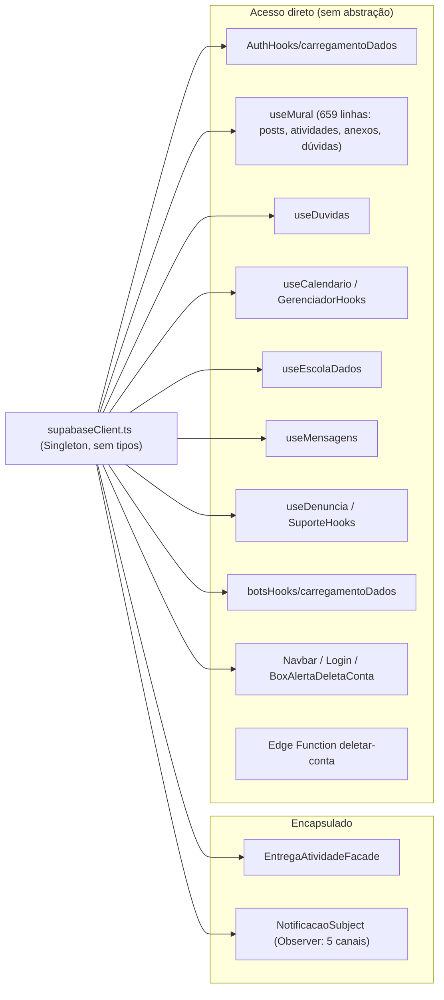
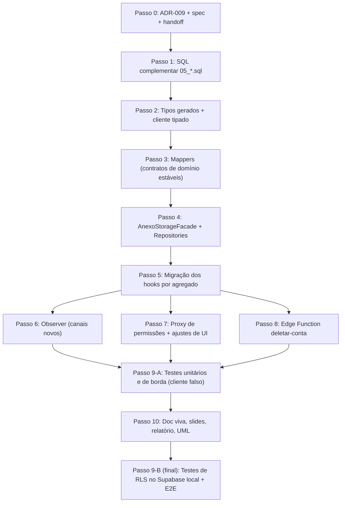
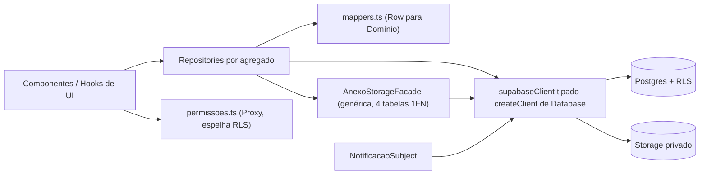

# Plano — Remodelagem das Interfaces e do Acesso ao Banco (Supabase) para o Novo Esquema SQL

> **Autor / Responsável:** Gianlucca Paiva (`GianluccaPaiva`) · **Registro:** 2026-11-17 · **Status:** Aprovado (decisões registradas em 2026-11-17 por Gianlucca Paiva — ver seção *Decisões da Dupla*) — pronto para execução
> **Base:** `docker/constructionsSQL/01_esquema.sql` + `04_supabase_auth_rls.sql` (ADR-008), navegação via `graphify-out/`.

## Objetivo

A trilha de banco (ADR-008, Gianlucca Paiva, 16/11) reescreveu o modelo em [01_esquema.sql](../docker/constructionsSQL/01_esquema.sql) e [04_supabase_auth_rls.sql](../docker/constructionsSQL/04_supabase_auth_rls.sql). Nenhuma linha de `src/` foi adaptada: **toda a camada de acesso da SPA ainda fala com o esquema legado** (`supabase/001..006_*.sql`). Se apontarmos o app para o banco novo, **quase todas as consultas quebram**.

Este plano faz três coisas:
1. Mapeia, com o `graphify-out/` como navegação, a arquitetura atual de conexões com o Supabase.
2. Compara essa arquitetura com o esquema e as RLS novos e lista as divergências.
3. Propõe a remodelagem em **passos**, com os padrões que resolvem problemas reais e os testes de cada passo.

---

## 1. Arquitetura atual de conexões (via graphify)

O grafo (`GRAPH_REPORT.md`, `COMPASS.md`) mostra que só **um** caminho de dados está encapsulado: `EntregaAtividadeFacade`, o nó mais conectado, com 11 arestas. O resto da comunicação sai do Singleton `supabase` (`supabaseClient.ts`, comunidade 649 → `hasSupabaseConfig, supabase`) direto para hooks e componentes. O inventário com `git grep` encontrou **19 arquivos e cerca de 85 chamadas** `.from()/.storage/.channel`.



Problemas estruturais:
- **Cliente sem tipos** (`createClient(url, key)` sem `<Database>`): nomes de tabela e coluna são strings soltas, então a mudança de esquema **não gera nenhum erro de compilação**.
- **Formatos do banco espalhados pela UI**: os tipos (`PerfilUsuario.id`, `Atividade.anexo_url`, `Duvida.prof_id`...) são cópias das linhas legadas. Por isso, renomear uma coluna exige mexer em componentes.
- **Lógica de anexo duplicada 4 vezes**: upload + `getPublicUrl` + `JSON.stringify(urls)` aparece em `useMural` (atividade, dúvida), `SuporteHooks` e na Facade.

---

## 2. Comparação: esquema legado (usado pelo app) × esquema novo

### 2.1 Tabelas e colunas

| Legado (`src/`) | Novo (`01_esquema.sql`) | Mudanças que quebram o app |
|:---|:---|:---|
| `perfis` (`id`) | `perfil` (`id_perfil`, **`id_escola`**) | PK renomeada; `id_escola` obrigatório para aluno/professor (CHECK) |
| `escolas` (`id`) | `escola` (`id_escola`) | PK |
| `turmas_escolares` (`id, chave, turma, escola_id`) | `turma` (`id_turma, codigo_acesso, periodo_escolar, id_escola`) | 4 renomeações; PK passa a ser `SERIAL` |
| `aluno_turma`/`professor_turma` (`aluno_id, turma_id`) | mesmas tabelas (`id_aluno, id_turma, situacao`) | colunas renomeadas; `situacao` ('ativa'/'cancelada') |
| `atividades` (`anexo_url` JSON, `created_at`, `data_entrega` nulo) | `atividade` + **`atividade_anexo`** (1FN) | anexos viram linhas que referenciam `storage.objects.id`; `data_entrega NOT NULL`; sem `created_at` |
| `entregas_atividades` (`url_anexo, no_prazo, updated_at`) | `entrega_atividade` (`id_objeto_storage`) | caminho vira UUID do objeto; `no_prazo`/`updated_at` removidos; `onConflict` passa a `id_atividade,id_aluno` |
| `duvidasalunostoprofessor` (`prof_id, resolvido, anexo_url`) | `duvida` + **`duvida_anexo`** (`id_professor, resolveu`) | renomeações + anexos em 1FN |
| `mural_posts` (`autor_id`) | `mural_post` (`id_post, id_autor`) + `comentario_mural` (nova) | renomeações |
| `eventos_calendario` (`horario` nulo) | `evento_calendario` (`horario NOT NULL`) | renomeações; horário passa a ser obrigatório |
| `alertas_calendario` (gerados por `pg_cron`) | `alerta_calendario` (`id_evento`, sem `titulo_evento`) | **o gerador de alertas não existe no esquema novo** |
| `mensagens` (`remetente_id`, `assunto`) | `mensagem` (`id_remetente`; sem `assunto`) | renomeações + CHECK remetente ≠ destinatário |
| `denuncias` (`aluno_denunciado` texto) | `denuncia` (`id_autor, id_denunciado` UUID) | a UI hoje envia **nome**; o banco exige UUID |
| `suporte` (`nome, email, anexos_urls[]`) | `ticket_suporte` (`id_perfil`) + `ticket_suporte_anexo` | nome/e-mail passam a vir de `perfil`; anexos em 1FN |

### 2.2 Regras de acesso (RLS) que mudam o comportamento da UI

| Regra nova (RLS) | Impacto no código atual |
|:---|:---|
| `Turma` e `Professor_Turma`: **INSERT/UPDATE/DELETE só pelo master** | `useGerenciador.mudarInscricao` deixa o **professor** se inscrever em `professor_turma`, o que passa a falhar. |
| `Perfil` INSERT: só o próprio usuário, `role='aluno'` e `id_escola` preenchido | `Login.signUp` só envia `{ nome }`, sem trigger nem escola, então **o cadastro quebra**. |
| `Perfil` UPDATE: não pode mudar `role`/`id_escola` | `Navbar` atualiza `foto_url/bio`: continua funcionando. |
| Os 4 buckets agora são **privados** | `getPublicUrl()` (useMural ×2, SuporteHooks) gera links que **retornam 400/403**. É preciso usar `createSignedUrl(s)`. |
| `Aluno_Turma` INSERT exige mesma escola (RLS + trigger RN12) | É preciso tratar o erro `RN12` na UI. |
| Storage `entregas_atividades` DELETE: só dono/master | Ao excluir uma atividade, **o professor não consegue apagar os arquivos dos alunos**: a remoção é silenciosa e os arquivos ficam órfãos. |
| `Entrega_Atividade` UPDATE do aluno não pode mudar `nota/feedback` | A Facade já respeita isso. |

### 2.3 Pontos que faltam no próprio SQL (detectados na revisão)

1. **Sem `ALTER PUBLICATION supabase_realtime`**: os 5 canais do `NotificacaoSubject` ficariam mudos.
2. **Sem trigger `handle_new_user`**: o ADR-008 deixou isso como pendência (Risco 2).
3. **Sem gerador de `Alerta_Calendario`** (o legado usava `pg_cron`).
4. **O professor não apaga entregas no Storage** (item acima).
5. **FK `ON DELETE CASCADE` para `storage.objects`**: remover o objeto antigo **antes** de trocar a FK apaga a linha de `Entrega_Atividade`. A ordem das operações passa a ser regra de negócio.
6. O teste `EXISTS (... role = 'master')` se repete cerca de 150 vezes. A recomendação oficial do Supabase é usar uma função `STABLE SECURITY DEFINER` (`private.is_master()`). Isso é desempenho, não correção, e fica opcional.

---

## User Review Required

> [!IMPORTANT]
> **Restrição de governança:** o `GEMINI.md` proíbe padrões fora do `PLANEJAMENTO_REFATORACAO.md`. Este plano **reaproveita** Facade, Singleton, Observer e Proxy e acrescenta **um padrão novo, Repository**, **aprovado pela dupla em 2026-11-17**. Esse aval precisa ser formalizado na **ADR-009** (Passo 0) antes de qualquer código.

> [!WARNING]
> **Ruptura de contrato no cadastro e na gestão de turmas:** com as RLS novas, o professor deixa de se inscrever sozinho em turmas e o cadastro passa a exigir escola. As mudanças de UI decorrentes (`Login`, `Pesquisar`/Gerenciador, formulários de atividade/evento, denúncia) foram **autorizadas explicitamente** em 2026-11-17.

> [!CAUTION]
> As alterações SQL do Passo 1 ficam em um **arquivo novo** (`05_...sql`). O `04_supabase_auth_rls.sql` não é reescrito, porque o ADR-008 pediu que ele contivesse só RLS. Nada é executado contra instância remota do Supabase.

## Decisões da Dupla (2026-11-17 — registrado por Gianlucca Paiva)

| # | Questão | Decisão | Efeito no plano |
|:---|:---|:---|:---|
| 1 | Escopo de "interfaces" e mudanças de tela | **Aprovado**: contratos TS + camada de acesso + ajustes de UI obrigatórios (cadastro com escola, `data_entrega`/`horario` obrigatórios, denúncia por UUID, sem "Inscrever-se" para professor) | Passo 7 entra integralmente |
| 2 | Padrão Repository | **Aprovado** (Opção 4-A); formalizar na ADR-009 | Opção 4-B descartada |
| 3 | Alertas de calendário | **Gerar no banco com `pg_cron`** (recomendação aceita), mantendo o fallback local já existente | Passo 1 inclui `fn_processar_alertas_calendario()` + `cron.schedule` |
| 4 | Testes de RLS reais (Supabase local) | **Adiados para o final** do ciclo (junto da Fase 6/E2E) | Passo 9 dividido: 9-A agora (unitários/borda), 9-B ao final (RLS no Supabase) |
| 5 | IDs `SERIAL` como `string` no domínio | **Aprovado** | Mappers convertem `number → string`; repositórios convertem de volta |

### Justificativa da decisão 3 (alertas via `pg_cron`)
- **O esquema novo foi desenhado para isso:** `minutos_antes IN (1, 5)`, `lembrete_para` e `UNIQUE (id_evento, minutos_antes, lembrete_para)` tornam o job idempotente. Calcular no navegador deixaria a tabela sem uso.
- **Fonte única da verdade:** um único job no servidor gera o alerta, e o Observer (`conectarCanalAlertasCalendarioRealtime`) só o distribui via Realtime. No cliente, cada aba aberta recalcularia e precisaria deduplicar.
- **Continuidade:** repete o desenho legado (`supabase/001_eventos_calendario.sql → processar_alertas_antecedencia`). O código atual já consome esse fluxo e tem `verificarLembretesLocais` como reserva quando o Realtime falha.
- **Ressalva:** `pg_cron` só existe no Supabase (hospedado ou CLI local), não no Postgres puro de `docker/structure`. Isso não muda o cenário, porque o esquema já depende de `auth` e `storage`.

---

## Proposed Changes (em passos)



Arquitetura-alvo:



---

### Passo 0: Governança (antes de codar)

#### [NEW] `.agents/decisions/adr-009-camada-acesso-dados-esquema-normalizado.md`
Registra: cliente tipado, mappers, `AnexoStorageFacade` genérica, Repository (se aprovado), a ordem obrigatória Storage↔FK e o arquivo SQL complementar.
#### [NEW] `.agents/features/fase-6a-remodelagem-acesso-banco.md`
Spec com riscos (RBT), arquivos tocados e rollback. Autor via `git config user.name`.

---

### Passo 1: SQL complementar (sem tocar no `04`)

#### [NEW] `docker/constructionsSQL/05_supabase_funcoes_realtime.sql`
```sql
-- 1. Perfil automático no signUp (padrão oficial Supabase)
CREATE OR REPLACE FUNCTION public.handle_new_user()
RETURNS trigger LANGUAGE plpgsql SECURITY DEFINER SET search_path = '' AS $$
BEGIN
  INSERT INTO public.Perfil (id_perfil, role, nome, email, id_escola)
  VALUES (NEW.id, 'aluno',
          COALESCE(NEW.raw_user_meta_data->>'nome', split_part(NEW.email,'@',1)),
          NEW.email,
          (NEW.raw_user_meta_data->>'id_escola')::int);
  RETURN NEW;
END; $$;
CREATE TRIGGER on_auth_user_created AFTER INSERT ON auth.users
  FOR EACH ROW EXECUTE FUNCTION public.handle_new_user();

-- 2. Realtime para o Observer
ALTER PUBLICATION supabase_realtime ADD TABLE
  public.Mural_Post, public.Atividade, public.Entrega_Atividade,
  public.Mensagem, public.Alerta_Calendario;

-- 3. Professor da turma pode remover arquivos de entregas da própria atividade
CREATE POLICY "Storage entregas_atividades: exclusao professor da turma"
  ON storage.objects FOR DELETE TO authenticated USING (
    bucket_id = 'entregas_atividades' AND EXISTS (
      SELECT 1 FROM public.Entrega_Atividade ea
      JOIN public.Atividade a ON a.id_atividade = ea.id_atividade
      JOIN public.Professor_Turma pt ON pt.id_turma = a.id_turma
      WHERE ea.id_objeto_storage = objects.id
        AND pt.id_professor = (SELECT auth.uid())));

-- 4. Alertas de calendário via pg_cron (Decisão 3) — adaptação do legado processar_alertas_antecedencia
CREATE EXTENSION IF NOT EXISTS pg_cron;
CREATE OR REPLACE FUNCTION public.fn_processar_alertas_calendario()
RETURNS void LANGUAGE plpgsql SECURITY DEFINER SET search_path = '' AS $$
BEGIN
  DELETE FROM public.Alerta_Calendario WHERE lembrete_para <= now() - interval '1 minute';
  INSERT INTO public.Alerta_Calendario (mensagem, minutos_antes, lembrete_para, id_evento)
  SELECT format('Lembrete: "%s" começa em %s minuto%s.', e.titulo, alvo.m,
                CASE WHEN alvo.m = 1 THEN '' ELSE 's' END),
         alvo.m,
         (e.data + e.horario) - make_interval(mins => alvo.m),
         e.id_evento
  FROM public.Evento_Calendario e
  CROSS JOIN (VALUES (5), (1)) AS alvo(m)
  WHERE (e.data + e.horario) BETWEEN now() + make_interval(mins => alvo.m)
                                 AND now() + make_interval(mins => alvo.m + 1)
  ON CONFLICT ON CONSTRAINT uq_alerta_evento_tempo_dest DO NOTHING;  -- idempotente
END; $$;
REVOKE EXECUTE ON FUNCTION public.fn_processar_alertas_calendario() FROM PUBLIC, anon, authenticated;
SELECT cron.schedule('processar_alertas_calendario', '* * * * *',
                     'SELECT public.fn_processar_alertas_calendario();');

-- 5. (Opcional) private.is_master() STABLE SECURITY DEFINER para desempenho
```

---

### Passo 2: Singleton tipado (a principal ferramenta da migração)

#### [NEW] `src/lib/database.types.ts`
Gerado com `npx supabase gen types typescript --local > src/lib/database.types.ts` (o CLI do Supabase já está no projeto, em `supabase/.temp`). **Nenhuma biblioteca nova.**
#### [MODIFY] `src/lib/supabaseClient.ts`
```diff
-export const supabase = createClient(__URL_SUPABASE__, __KEY_SUPABASE__)
+import type { Database } from "./database.types"
+export const supabase = createClient<Database>(__URL_SUPABASE__, __KEY_SUPABASE__)
+export type TabelaRow<T extends keyof Database["public"]["Tables"]> =
+  Database["public"]["Tables"][T]["Row"]
```
**Por que funciona:** depois dessa mudança, `npx tsc -b --noEmit` aponta **todas** as cerca de 85 chamadas com tabela ou coluna obsoleta. É a lista de trabalho dos passos seguintes, verificada pelo compilador.

---

### Passo 3: Mappers (Data Mapper leve, funções puras)

#### [NEW] `src/lib/db/mappers.ts`
Convertem linhas do banco em modelos de domínio e **preservam os contratos atuais da UI** (`PerfilUsuario.id`, `TurmaProps`, `Atividade`, `Duvida`, `Entrega`). Os componentes quase não mudam.
```ts
export const mapPerfil = (r: TabelaRow<"perfil">): PerfilUsuario => ({
  id: r.id_perfil, nome: r.nome, email: r.email, foto_url: r.foto_url,
  bio: r.bio, created_at: r.created_at, role: r.role as PerfilUsuario["role"],
  id_escola: r.id_escola !== null ? String(r.id_escola) : null,
});
export const mapEntrega = (r: EntregaRow, dataEntrega: string): Entrega => ({
  id: String(r.id_entrega), atividade_id: String(r.id_atividade), aluno_id: r.id_aluno,
  id_objeto_storage: r.id_objeto_storage, nota: r.nota, feedback: r.feedback,
  entregue_em: r.entregue_em,
  no_prazo: new Date(r.entregue_em) <= new Date(dataEntrega), // antes vinha de coluna/trigger
});
export const umOuPrimeiro = <T,>(v: T | T[] | null | undefined) =>
  Array.isArray(v) ? v[0] ?? null : v ?? null; // substitui os 6 "Array.isArray(x.perfis)" duplicados
```
#### [MODIFY] tipos em `src/hooks/*/type.ts`
`anexo_url: string | null` → `anexos: AnexoRef[]` (`{ idObjeto, caminho, nome }`); remove `updated_at`/`created_at` de `Entrega`; `PerfilUsuario` ganha `id_escola`.

---

### Passo 4: Facade genérica de anexos + Repositories

#### [NEW] `src/patterns/facade/AnexoStorageFacade.ts` (extensão do padrão Facade existente)
Resolve a duplicação real: as 4 tabelas 1FN têm o mesmo formato (`id_objeto_storage` + FK do pai). A Facade recebe uma configuração e garante as **ordens seguras**:
```ts
export interface ConfigAnexo { bucket: string; tabela: "atividade_anexo"|"duvida_anexo"|"ticket_suporte_anexo"; colunaPai: string; }
export class AnexoStorageFacade {
  constructor(private cfg: ConfigAnexo, private client = supabase) {}
  // 1) upload → recebe data.id (docs supabase-js: { id, path, fullPath })
  // 2) INSERT na tabela de anexo com id_objeto_storage = data.id
  // 3) se o INSERT falhar → storage.remove([path]) (compensação, evita órfão)
  async anexar(idPai: number, arquivos: File[], prefixo: string): Promise<AnexoRef[]>
  // remove pela Storage API (nunca por SQL); a FK em CASCADE apaga a linha de anexo
  async remover(refs: AnexoRef[]): Promise<void>
  // buckets privados → createSignedUrls (lote) em vez de getPublicUrl
  async urlsAssinadas(refs: AnexoRef[], ttl = 3600): Promise<Record<string,string>>
}
```
#### [MODIFY] `src/patterns/facade/EntregaAtividadeFacade.ts`
`TABELA_ENTREGAS = "entrega_atividade"`, `onConflict: "id_atividade,id_aluno"`, grava `id_objeto_storage: uploadData.id`, remove `updated_at`, join `perfil:id_aluno(nome)`. **Reenvio na ordem segura:** upload do novo → UPSERT apontando para o novo id → só então `remove()` do objeto antigo. Na ordem inversa, o CASCADE apagaria a entrega.

#### Opção 4-A (aprovada, Decisão 2; formalizar na ADR-009): Repository por agregado, em `src/repositories/`
Os hooks precisam ser reescritos de qualquer jeito. Concentrar o acesso evita repetir o problema e deixa os hooks testáveis com repositório falso. **Só 6 repositórios**, um por agregado com regra própria:

| Repository | Absorve chamadas de | Regras centralizadas |
|:---|:---|:---|
| `PerfilRepository` | `AuthHooks/carregamentoDados`, `Navbar`, `usePerfilUsuario` | busca por `id_perfil`; update sem `role` |
| `EscolaTurmaRepository` | `useEscolaDados`, `GerenciadorHooks` | joins `professor_turma`/`aluno_turma`; matrícula com `situacao`; erro RN12 traduzido |
| `AtividadeRepository` | `useMural` (atividades), `botsHooks` | create/edit com `AnexoStorageFacade`; delete em ordem (entregas Storage → anexos Storage → linha) |
| `DuvidaRepository` | `useDuvidas`, `useMural` (enviar dúvida), `botsHooks` | `resolveu`, anexos 1FN |
| `MuralRepository` | `useMural` (posts), `botsHooks` | `mural_post` + `comentario_mural` |
| `ComunicacaoRepository` | `useCalendario`, `useMensagens`, `useDenuncia`, `SuporteHooks` | evento/alerta, mensagem, denúncia por UUID, ticket + anexos |

Contrato com injeção de cliente, no mesmo estilo da Facade atual:
```ts
export interface IAtividadeRepository {
  listarPorTurma(idTurma: string): Promise<Atividade[]>;
  criar(dados: NovaAtividade, arquivos: File[]): Promise<Atividade>;
  editar(id: string, dados: EdicaoAtividade, novos: File[], removidos: AnexoRef[]): Promise<Atividade>;
  excluir(atividade: Atividade): Promise<void>;
}
```
#### ~~Opção 4-B (sem padrão novo)~~ (descartada, Decisão 2)
Seria só Facade + mappers, com os hooks chamando `supabase` direto. Fica registrada como anti-decisão na ADR-009.

---

### Passo 5: Migração dos hooks (ordem de dependência)

1. `AuthHooks/carregamentoDados.ts`, `useAuth.ts` (o Perfil é a base de tudo)
2. `LeituraDataHooks/useEscolaDados.ts`, `GerenciadorHooks/*` (Turma/matrícula)
3. `EntregaAtividadeFacade` + `MuralHooks/useMural.ts` (dividido entre os repositórios; o hook de 659 linhas encolhe)
4. `DuvidaHooks/useDuvidas.ts`
5. `CalendarioHooks/useCalendario.ts`
6. `MensagensHooks/*` (`TABELA_MENSAGENS = "mensagem"`, sem `assunto`)
7. `DenunciaHooks`, `SuporteHooks/loadData.ts`
8. `botsHooks/carregamentoDados.ts` (Function Calling do Tigreso)
9. `InfoAplicacao/configEngenhariaSoftware.ts` (exemplos de código nos slides)

Critério de cada item: `npx tsc -b --noEmit` sem erros no arquivo + suíte verde.

---

### Passo 6: Observer

#### [MODIFY] `src/patterns/observer/NotificacaoSubject.ts`
Centraliza as definições de canal em uma tabela de configuração. Hoje são 3 blocos copiados.
```ts
const CANAIS_MURAL = [
  { nome: "realtime:mural_post", table: "mural_post", filtro: (t) => `id_turma=eq.${t}`, campoAutor: "id_autor", tipo: "NOVO_POST_MURAL" },
  { nome: "realtime:atividade",  table: "atividade",  filtro: (t) => `id_turma=eq.${t}`, campoAutor: "id_professor", tipo: "NOVA_ATIVIDADE_TURMA" },
] as const;
// entrega: table "entrega_atividade", filter `id_aluno=eq.${alunoId}`
// alertas: table "alerta_calendario"; mensagens: "mensagem" + id_remetente/id_destinatario
```

---

### Passo 7: Proxy de proteção alinhado à RLS + ajustes de UI

#### [NEW] `src/lib/permissoes.ts` (funções puras que espelham a RLS)
```ts
export const pode = {
  criarTurma: (p: PerfilUsuario) => p.role === "master",
  inscreverEmTurma: (p: PerfilUsuario, t: TurmaProps) => p.role === "aluno" && p.id_escola === t.id_escola,
  publicarAtividade: (p, t) => p.role === "master" || (p.role === "professor" && t.professor_id === p.id),
  excluirPost: (p, post, t) => p.role === "master" || post.autor?.id === p.id || t.professor_id === p.id,
};
```
Consumidas por `BoxRestrito` e pelos botões. A UI esconde as ações que a RLS negaria, em vez de falhar com erro.
#### [MODIFY] UI (autorizado, Decisão 1)
- `Login.tsx`: seletor de escola (lê `escola`, leitura pública na RLS) → `signUp({ options: { data: { nome, id_escola } } })`.
- Formulários de atividade e evento: `data_entrega` e `horario` obrigatórios (NOT NULL).
- `useGerenciador.mudarInscricao`: só para aluno (professor/master não veem "Inscrever-se").
- `useDenuncia`: envia `id_denunciado` (UUID) em vez do nome.

---

### Passo 8: Edge Function

#### [MODIFY] `supabase/functions/deletar-conta/index.ts`
Com `perfil → auth.users ON DELETE CASCADE`, as 8 exclusões manuais viram: (1) listar os objetos do usuário nas tabelas de anexo/entrega, (2) `storage.remove()` por bucket, (3) `auth.admin.deleteUser()`. O banco apaga o resto em cascata.

---

### Passo 9-A: Testes novos e ajustados (durante o ciclo, sem Supabase real)

| Arquivo | Nível RBT | O que garante |
|:---|:---|:---|
| [NEW] `testes/lib/db/mappers.spec.ts` | 2 (unitário puro) | renomeações `id_*`→`id`; `no_prazo` derivado (antes/depois/igual ao prazo); `umOuPrimeiro` com objeto/array/null; ids SERIAL → string |
| [NEW] `testes/lib/permissoes.spec.ts` | 2 | matriz papel × ação idêntica à RLS (professor **não** cria turma; aluno de outra escola **não** se inscreve; master pode tudo) |
| [NEW] `testes/patterns/facade/anexoStorageFacade.spec.ts` | 3 (cliente falso na borda) | usa `data.id` do upload no INSERT; **compensação**: INSERT falha → `remove` do objeto; `createSignedUrls` em vez de `getPublicUrl`; remoção só via Storage API |
| [MODIFY] `testes/patterns/facade/entregaAtividadeFacade.spec.ts` | 3 | tabela/colunas novas, `onConflict "id_atividade,id_aluno"`, **ordem do reenvio** (UPSERT antes do `remove` antigo), sem `updated_at` |
| [MODIFY] `testes/patterns/observer/notificacaoObserver.spec.ts` | 3 | nomes de tabela/filtro novos (`id_turma=eq.`, `id_aluno=eq.`) e campos `id_autor`/`id_professor` |
| [NEW] `testes/repositories/atividadeRepository.spec.ts` | 3 | ordem de exclusão (Storage entregas → Storage anexos → linha); criação com anexos via Facade |
| [NEW] `testes/repositories/escolaTurmaRepository.spec.ts` | 3 | matrícula só de aluno; erro `RN12` traduzido em mensagem amigável |
| [NEW] `testes/repositories/duvidaRepository.spec.ts` | 3 | `resolveu` + anexos 1FN |

**Passo 9-B (ao final do ciclo, Decisão 4): testes no nível Supabase**

| Arquivo | Nível RBT | O que garante |
|:---|:---|:---|
| [NEW] `testes/integracao/rls.spec.ts` | 3 (Supabase local, `01 → 04 → 05 → 02`) | com usuários seed: aluno não altera `nota`; professor não cria `turma`; aluno de escola X não se matricula na escola Y (RN12); professor apaga arquivo de entrega da própria turma; buckets privados negam acesso a não membros |
| [NEW] `testes/integracao/alertasCalendario.spec.ts` | 3 | `fn_processar_alertas_calendario()` gera alertas de 5 e 1 min e, executada duas vezes, não duplica |
| [NEW] `testes/integracao/handleNewUser.spec.ts` | 3 | `signUp` com `id_escola` cria `perfil` aluno; sem escola, falha pelo CHECK |

Nenhum teste de UI pura (proibido pelo Nível 1 RBT).

---

### Passo 10: Documentação obrigatória

- [MODIFY] `.docs/DOCUMENTACAO_APRESENTACAO.md` (Handoff, Painel, Diário, com o autor)
- [MODIFY] `src/hooks/InfoAplicacao/configEngenhariaSoftware.ts` (slides antes/depois e cobertura)
- [NEW] `relatorios/2026-11/2026-11-XX-remodelagem-acesso-banco.md` (campo `Autor`)
- [MODIFY] `out/diagramas/diagrama_classes_detalhado.puml` (Repository/AnexoStorageFacade)
- [MODIFY] `.agents/INICIALIZACAO.md` (índice)

---

## Verification Plan

### Automated Tests
```powershell
npx tsc -b --noEmit                 # após cada passo com .ts/.tsx (zero erros = zero colunas obsoletas)
npx vitest run                      # suíte completa
npm run test:coverage               # src/lib + src/patterns (+ src/repositories) mantendo 100%
git grep -n -E "getPublicUrl|perfis|turmas_escolares|mural_posts|duvidasalunostoprofessor|entregas_atividades\"\)|\"mensagens\"" -- src   # deve retornar vazio (exceto nomes de bucket)
```
### Manual Verification (Passo 9-B, ao final: Supabase local, `01 → 04 → 05 → 02`)
1. Cadastro com escola → `perfil` criado pelo trigger.
2. Aluno se matricula numa turma da própria escola (ok) e de outra escola (mensagem RN12).
3. Professor cria atividade com 2 anexos → abre os anexos (URL assinada) → exclui a atividade → buckets sem órfãos.
4. Aluno entrega e reenvia → a entrega permanece e o arquivo antigo é removido.
5. Toasts realtime de post, atividade e mensagem chegando.
