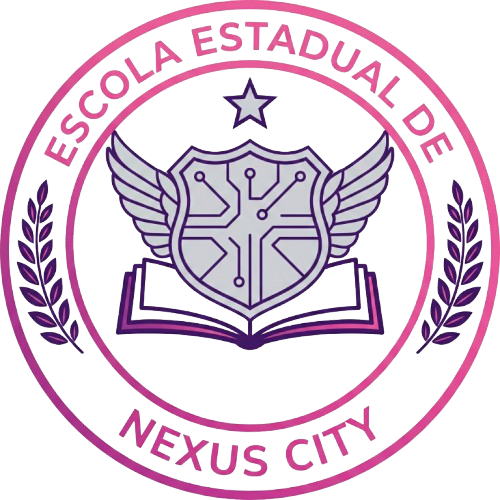

<div align="center">



# NexusClass

Plataforma educacional interativa projetada para modernizar a comunicação e gestão escolar entre alunos, professores e administradores. Construída com **React 19**, **TypeScript**, **Tailwind CSS v4**, **Supabase**, **Google Gemini AI** e refatorada sob práticas de **Engenharia de Software (DCC061 — Design Patterns, Testes Automatizados e Segurança OWASP)**.

[](https://nodejs.org)
[](https://react.dev)
[](https://www.typescriptlang.org)
[](https://vite.dev)
[](https://tailwindcss.com)
[](https://supabase.com)
[](https://ai.google.dev)
[](https://vitest.dev)

[](https://nexus-class-two.vercel.app/login)

[Acesso](#-acesso-à-aplicação) • [Visão Geral](#-visão-geral) • [Engenharia de Software](#-engenharia-de-software-dcc061) • [Testes e Qualidade](#-testes-automatizados-e-cobertura) • [Segurança](#-segurança-e-hardening-owasp) • [Modelagem](#-modelagem-e-diagramas) • [Recursos](#-recursos-principais) • [Instalação](#-instalação-e-configuração) • [Estrutura](#-estrutura-do-projeto)

</div>

---

## 🔗 Acesso à Aplicação

> [!TIP]
> **Acesse o NexusClass em produção:** [https://nexus-class-two.vercel.app/login](https://nexus-class-two.vercel.app/login)

A aplicação também conta com uma aba interativa interna (**Informações → Engenharia de Software**) que apresenta os padrões aplicados (Antes vs. Depois), a evolução das métricas de testes e o resumo do hardening de segurança.

---

## 🌐 Visão Geral

O **NexusClass** é uma solução escolar integrada de ponta a ponta. Conecta alunos, professores e administradores (`master`) em um ecossistema digital composto por mural de avisos, chat em tempo real, assistentes virtuais inteligentes alimentados por IA (**Tigreso** e **Falcão Peregrino** via Google Gemini), central de atividades com controle de prazos e avaliação docente, canal de dúvidas com anexos normalizados (1FN), calendário letivo com alertas automáticos e fluxo transacional de exclusão de conta.

---

## 🧩 Engenharia de Software (DCC061)

O projeto passou por uma refatoração arquitetural estruturada para reduzir acoplamento entre interface, regras de negócio e infraestrutura (Supabase e Gemini), aplicando **7 padrões GoF**, **Repository Pattern** e **Data Mappers** apenas onde havia problema real no código (sem *overengineering*).

### Catálogo de Padrões de Projeto (`src/patterns/` e `src/repositories/`)

| Padrão | Categoria | Implementação | Problema real resolvido |
| :--- | :--- | :--- | :--- |
| **Adapter** | GoF Estrutural | [`GeminiAdapter.ts`](src/patterns/adapter/GeminiAdapter.ts) | Isola o SDK `@google/generative-ai`, *Function Calling* (4 ferramentas) e *retry* exponencial (`503`) por trás da interface `IAssistenteIA`. |
| **Factory** | GoF Criacional | [`BotFactory.ts`](src/patterns/factory/BotFactory.ts) | Centraliza a instanciação determinística dos assistentes **Tigreso** e **Falcão Peregrino** e a composição de instruções por papel. |
| **Facade** | GoF Estrutural | [`EntregaAtividadeFacade.ts`](src/patterns/facade/EntregaAtividadeFacade.ts)<br>[`AnexoStorageFacade.ts`](src/patterns/facade/AnexoStorageFacade.ts) | Orquestra operações coordenadas entre Supabase Storage (`upload`, `createSignedUrls`, compensação em erro) e PostgreSQL (`upsert`, avaliação e anexos 1FN). |
| **Strategy** | GoF Comportamental | [`FiltroStrategy.ts`](src/patterns/strategy/FiltroStrategy.ts)<br>[`SanitizacaoStrategy.ts`](src/patterns/strategy/SanitizacaoStrategy.ts) | Elimina condicionais duplicados nos filtros de turmas/dúvidas e centraliza a sanitização contextual OWASP em 3 estratégias puras sem dependências externas. |
| **Observer** | GoF Comportamental | [`NotificacaoSubject.ts`](src/patterns/observer/NotificacaoSubject.ts) | Desacopla os 5 canais Supabase Realtime (`mural`, `atividades`, `entregas`, `alertas`, `mensagens`) dos efeitos de Toast, atualização de estado e badges. |
| **Singleton** | GoF Criacional | [`supabaseClient.ts`](src/lib/supabaseClient.ts) | Garante instância única tipada (`createClient<Database>`) do cliente Supabase via cache nativo de ES Modules ([doc](src/patterns/singleton/README.md)). |
| **Protection Proxy** | GoF Estrutural | [`ProtectedRoute.tsx`](src/components/ProtectedRoute.tsx) · [`BoxRestrito.tsx`](src/components/BoxRestrito.tsx) · [`permissoes.ts`](src/lib/permissoes.ts) | Intercepta rotas autenticadas e ações restritas por papel na UI, em defesa em profundidade com as políticas RLS ([doc](src/patterns/proxy/README.md)). |
| **Repository & Data Mapper** | Arquitetural | [`src/repositories/`](src/repositories/) · [`mappers.ts`](src/lib/db/mappers.ts) | Isola todas as consultas ao esquema normalizado de 18 tabelas em 6 repositórios de domínio (`Perfil`, `EscolaTurma`, `Atividade`, `Duvida`, `Mural`, `Comunicacao`). |

> **Decisões de simplicidade registradas:** *Template Method* foi descartado por os formulários possuírem fluxos distintos (evitando herança artificial), e `DOMPurify` foi dispensado por não haver uso de `dangerouslySetInnerHTML`/`innerHTML` em `src/`. Consulte o catálogo completo em [`src/patterns/README.md`](src/patterns/README.md).

---

## 🧪 Testes Automatizados e Cobertura

A estratégia de testes segue **Risk-Based Testing (RBT)** com foco em determinismo (uso de *Fake Timers*, dublês em memória, Particionamento de Equivalência, Análise de Valor Limite e Tabela de Decisão), executada com **Vitest** e cobertura **V8**:

| Indicador | Antes (Baseline) | Estado Atual |
| :--- | :--- | :--- |
| **Suítes / Testes automatizados** | 1 arquivo (3 testes) | **19 arquivos (144 testes)** |
| **Statements (`src/lib` + `src/patterns`)** | `4.27%` | **98.16%** |
| **Branches (`src/lib` + `src/patterns`)** | `0%` | **93.35%** |
| **Functions (`src/lib` + `src/patterns`)** | `4.00%` | **100%** |
| **Lines (`src/lib` + `src/patterns`)** | `4.42%` | **100%** |
| **Verificação SQL em Docker (`03_verificacao.sql`)** | — | **16/16 casos reversíveis (`ROLLBACK`)** |

---

## 🛡️ Segurança e Hardening (OWASP)

As validações de segurança (Burp Suite, Wapiti, SQLmap e testes de XSS) foram consolidadas em defesa em profundidade nas camadas de interface, Edge Functions, hospedagem e banco de dados:

- **Row Level Security (RLS):** 18 tabelas protegidas por políticas baseadas em `auth.uid()` e papéis (`aluno`, `professor`, `master`), impedindo escalada de privilégios no cadastro (`handle_new_user` fixa `role = 'aluno'`).
- **Código Público da Escola (`ESC-XXXXXXXX`):** evita enumeração sequencial de escolas no cadastro, com restrição de privilégio de coluna e RPC controlada.
- **Sanitização Contextual OWASP (`SanitizacaoStrategy`):** normalização de entradas nos repositórios (`TextoEntradaStrategy`), allowlist estrita `http:`/`https:` para URLs (`UrlHttpSeguraStrategy`), escape HTML em templates de e-mail (`EscapeHtmlStrategy`) e `CHECK` constraints no PostgreSQL (`16_protecao_urls_e_entradas.sql`).
- **Cabeçalhos HTTP de Segurança ([`vercel.json`](vercel.json)):** `Content-Security-Policy` (CSP), `Strict-Transport-Security` (HSTS), `X-Frame-Options: DENY`, `X-Content-Type-Options: nosniff`, `Referrer-Policy` e `Permissions-Policy`.
- **Edge Functions Autenticadas ([`supabase/functions/`](supabase/functions/)):** `deletar-conta`, `resend-email` e `resend-suport` executadas com verificação JWT (`verify_jwt: true`), checagem de titularidade e URLs assinadas temporárias.

---

## 🗺️ Modelagem e Diagramas

> [!NOTE]
> Acesse também o [Documento de Planejamento e Modelagem do NexusClass](https://docs.google.com/document/d/1By-bhNEzCsuZFOqb4rJt2Wj1VXxE5OucCwXfb5eE5Fk/edit?usp=sharing) para o levantamento de requisitos funcionais e não-funcionais.

Os diagramas PlantUML atualizados do sistema estão versionados em [`out/diagramas/`](out/diagramas/):
- **Diagrama de Classes (com estereótipos GoF e Repositories):** [`out/diagramas/diagrama_classes_detalhado.puml`](out/diagramas/diagrama_classes_detalhado.puml)
- **Modelo Entidade-Relacionamento (18 tabelas normalizadas):** [`out/diagramas/modelo_er.puml`](out/diagramas/modelo_er.puml)
- **Diagrama de Estados — Entrega de Atividade:** [`out/diagramas/diagrama_estados_entrega.puml`](out/diagramas/diagrama_estados_entrega.puml)
- **Diagrama de Estados — Central de Dúvidas:** [`out/diagramas/diagrama_estados_duvida.puml`](out/diagramas/diagrama_estados_duvida.puml)

Os scripts SQL vigentes do banco e a infraestrutura Docker local ficam em [`docker/constructionsSQL/`](docker/constructionsSQL/) e [`docker/structure/`](docker/structure/).

---

## ✨ Recursos Principais

- **Painel de Turmas & Mural:** gestão escolar por instituição e turma, com mural de avisos, comentários e suporte a anexos normalizados.
- **Assistentes IA (Tigreso & Falcão Peregrino):** integração com Google Gemini AI com *Function Calling* para consultar agenda, atividades abertas, dúvidas e posts em tempo real.
- **Central de Atividades & Avaliação:** envio de arquivos em bucket privado do Supabase Storage, validação automática de atraso e portal docente para notas (`0` a `100`) e feedback.
- **Canal de Dúvidas (Fórum Aluno–Professor):** suporte a múltiplos anexos 1FN com limpeza sincronizada entre Storage e banco.
- **Calendário Letivo & Alertas Realtime:** eventos pessoais e de turma com job `pg_cron` (`fn_processar_alertas_calendario`) disparando alertas antes do início dos compromissos.
- **Privacidade & Exclusão de Conta (LGPD):** exclusão atômica via Edge Function `deletar-conta`, removendo perfil, vínculos e objetos de Storage (restrita ao papel `aluno`).

---

## 🛠️ Tecnologias Utilizadas

### Frontend & Qualidade
- **React 19** + **TypeScript 5.9** + **Vite 7**
- **Tailwind CSS v4**, **shadcn/ui**, **Radix UI**, **next-themes** e **Howler.js**
- **Vitest 5**, **@vitest/coverage-v8**, **Testing Library** e **Playwright**

### Backend, Banco & Infraestrutura
- **Supabase PostgreSQL** (18 tabelas, RLS, triggers, RPCs, `pg_cron`, `pgcrypto`)
- **Supabase Auth, Storage, Realtime e Edge Functions (Deno)**
- **Google Generative AI SDK (`@google/generative-ai`)**
- **Docker Compose** (PostgreSQL 17 local para desenvolvimento e testes SQL)

---

## 🚀 Instalação e Configuração

### Pré-requisitos
- **Node.js** `>= 18.0.0` e **npm**
- **Docker** *(opcional, para subir o PostgreSQL local e validar os scripts SQL)*

### Passo a passo

1. Clone o repositório e instale as dependências:
   ```bash
   git clone https://github.com/NexusMindCorp/NexusClass.git
   cd NexusClass
   npm install
   ```

2. Configure as variáveis de ambiente:
   ```bash
   cp .env.example .env
   ```
   Preencha o `.env` com as suas credenciais:
   ```env
   VITE_GEMINI_KEY=sua_chave_de_api_do_google_gemini
   VITE_SUPABASE_URL=sua_url_do_projeto_supabase
   VITE_SUPABASE_ANON_KEY=sua_chave_anonima_publica_do_supabase
   ```

   > [!IMPORTANT]
   > Sem as credenciais do Supabase e do Gemini configuradas no `.env`, autenticação, persistência e os assistentes de IA não funcionarão.

3. Inicie o servidor de desenvolvimento:
   ```bash
   npm run dev
   ```

---

## 📁 Estrutura do Projeto

```text
NexusClass/
├── src/
│   ├── components/          # Componentes de interface (ui/ shadcn, provedores e telas)
│   ├── hooks/               # Custom hooks por domínio (Auth, Mural, Entregas, Dúvidas, Bots, InfoAplicacao)
│   ├── Layout/              # Estruturas base de layout
│   ├── lib/                 # Cliente Supabase tipado, database.types.ts, mappers, permissões e utilitários
│   ├── patterns/            # Catálogo GoF (adapter, factory, facade, strategy, observer, singleton, proxy)
│   ├── repositories/        # Camada Repository de acesso ao esquema normalizado (6 repositórios)
│   └── referenciaGlobal/    # Tipos globais TypeScript
├── testes/                  # Suítes Vitest (lib, patterns, repositories e ui)
├── docker/
│   ├── constructionsSQL/    # Esquema consolidado, carga, verificação (16 casos) e migrações
│   └── structure/           # docker-compose.yml (PostgreSQL 17)
├── supabase/functions/      # Edge Functions Deno (deletar-conta, resend-email, resend-suport)
├── out/diagramas/           # Diagramas PlantUML (Classes GoF, DER e Estados)
└── vercel.json              # Cabeçalhos HTTP de segurança (OWASP) e rewrites da SPA
```

---

## 📜 Scripts Disponíveis

| Comando | Descrição |
| :--- | :--- |
| `npm run dev` | Inicia o servidor local de desenvolvimento do Vite. |
| `npm run build` | Valida tipos com TypeScript (`tsc -b`) e gera o bundle de produção em `dist/`. |
| `npm run lint` | Executa o ESLint em todo o projeto. |
| `npm run preview` | Pré-visualiza localmente a build de produção. |
| `npm run test` | Executa o Vitest em modo interativo (*watch*). |
| `npm run test:run` | Executa todas as 19 suítes de teste (144 testes) uma única vez. |
| `npm run test:coverage` | Executa os testes com relatório de cobertura V8 (`src/lib` e `src/patterns`). |
| `npm run test:patterns` | Executa exclusivamente as suítes dos padrões GoF em `testes/patterns/`. |
| `npm run constructDocker` | Sobe/recria o banco PostgreSQL local via Docker Compose. |
| `npm run deploy` | Compila e publica a build estática no GitHub Pages. |
