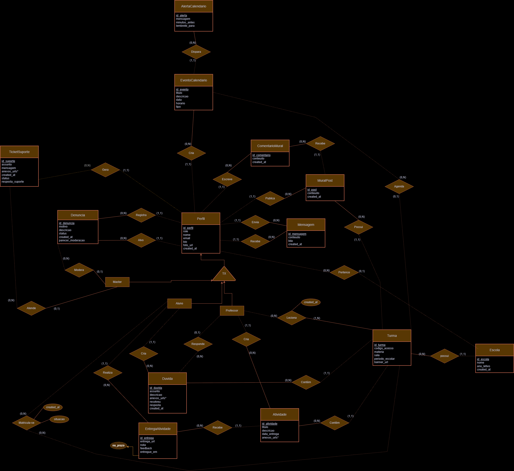

# Relatório NexusClass — Versão Reconciliada (DCC060 — Modelo v3)

## IDENTIFICAÇÃO DA EQUIPE

| Campo | Informação |
| :--- | :--- |
| **Tema** | **NexusClass** — Plataforma Educacional (LMS) com Salas de Aula Virtuais, Entregas, Fórum de Dúvidas, Calendário com Alertas e Moderação |
| **SGBD utilizado** | **PostgreSQL 14+** (homologado em Docker PostgreSQL/Supabase local e Supabase hospedado `REF_DO_PROJETO`) |
| **Disciplina / Grupo** | DCC060 — Banco de Dados (2026.3) — **Grupo 24** |
| **Responsável pela reconciliação** | Gianlucca Paiva (`GianluccaPaiva`) — **2026-11-22** (branch `DesiningTeste`) |

| Nome completo | Matrícula |
| :--- | :--- |
| Gabriel Lineker | 202476025 |
| Gianlucca Paiva | 202476026 |
| João Victor | 202265109AC |

> **Nota sobre preservação de artefatos originais da E4 e empacotamento final:** Os documentos entregues nas etapas anteriores ([`grupo24/relatorio.pdf`](relatorio.pdf), [`grupo24/modelo_trabalho_v3.pdf`](modelo_trabalho_v3.pdf) e os scripts legados para PostgreSQL puro arquivados em [`grupo24/sql_e4_historico/`](sql_e4_historico/) — com `entrega_url`, IDs inteiros e 11 testes) foram **preservados intactos como registro histórico da E4**. Este documento (`RELATORIO_ATUALIZADO.md`), sua versão exportada (`RELATORIO_ATUALIZADO.pdf`), o diagrama editável [`grupo24/modelo.drawio`](modelo.drawio), a imagem reconciliada [`grupo24/der.png`](der.png), [`grupo24/algebra/consultas_ar.md`](algebra/consultas_ar.md) e os scripts concatenados em ordem numérica estrita em [`grupo24/sql/`](sql/) (`01_esquema.sql`, `02_carga.sql`, `03_verificacao.sql`, `05_visoes.sql`, `06_triggers.sql`) consolidam o banco real validado até **2026-11-22**. *(Na montagem do arquivo `.zip` oficial de entrega da disciplina, renomear `RELATORIO_ATUALIZADO.pdf` → `relatorio.pdf` na raiz de `grupo24/`, mantendo `der.png` e `modelo.drawio`, conforme padrão obrigatório do `modelo_trabalho_v3.pdf`.)*

#### Índice Rápido de Artefatos (Histórico E4 vs. Pacote Reconciliado no Padrão Modelo v3)

| Categoria | Arquivos | Situação / Observação |
| :--- | :--- | :--- |
| **Histórico E4 (preservado intacto)** | [`relatorio.pdf`](relatorio.pdf), [`modelo_trabalho_v3.pdf`](modelo_trabalho_v3.pdf), [`sql_e4_historico/01_esquema.sql`](sql_e4_historico/01_esquema.sql), [`sql_e4_historico/02_carga.sql`](sql_e4_historico/02_carga.sql), [`sql_e4_historico/03_verificacao.sql`](sql_e4_historico/03_verificacao.sql) | Registro congelado da entrega E4 (esquema legado para PostgreSQL puro com `entrega_url`, PKs inteiras em `Perfil` e 11 testes). |
| **Pacote Reconciliado Vigente (Grupo 24)** | [`README.md`](README.md), [`RELATORIO_ATUALIZADO.md`](RELATORIO_ATUALIZADO.md), [`RELATORIO_ATUALIZADO.pdf`](RELATORIO_ATUALIZADO.pdf), [`modelo.drawio`](modelo.drawio), [`der.png`](der.png), [`algebra/consultas_ar.md`](algebra/consultas_ar.md) | Documentação, álgebra relacional e DER sincronizados com o esquema real de 18 tabelas no Supabase (migrações `01`–`17`). |
| **SQL Consolidado no Padrão Modelo v3 (`grupo24/sql/`)** | [`01_esquema.sql`](sql/01_esquema.sql) → [`02_carga.sql`](sql/02_carga.sql) → [`03_verificacao.sql`](sql/03_verificacao.sql) → *(`04_consultas.sql` E5)* → [`05_visoes.sql`](sql/05_visoes.sql) → [`06_triggers.sql`](sql/06_triggers.sql) → *(`07_indices.sql` E6)* | Concatenados a partir de [`../docker/constructionsSQL/`](../docker/constructionsSQL/) (`01`..`17`, mantidos intactos como trilha incremental) para executar **na ordem numérica estrita** sobre PostgreSQL/Supabase. |

---

## 1. INTRODUÇÃO

**Contexto e Domínio Escolhido:** O presente documento descreve os requisitos, as regras de negócio, a modelagem conceitual e lógica, a análise de normalização, as consultas em Álgebra Relacional e o modelo físico validado do **NexusClass**, uma plataforma de Gestão de Aprendizagem (*Learning Management System* — LMS) voltada ao cotidiano de salas de aula virtuais em instituições de ensino. Embora a identidade visual da interface tenha partido de uma prototipação anterior de outra disciplina, toda a arquitetura do banco de dados relacional foi concebida do zero para **DCC060**, amadurecendo posteriormente para implantação integrada em **PostgreSQL 14+ gerenciado sobre a stack Supabase** (integrando autenticação em `auth.users`, armazenamento privado de arquivos em `storage.objects`, segurança em nível de linha via Row Level Security, replicação em tempo real via `supabase_realtime` e agendamento temporal via `pg_cron`).

**Problema Resolvido:** No cotidiano escolar e universitário, a comunicação e a gestão pedagógica frequentemente se dispersam entre múltiplas ferramentas desconexas (mensageiros informais, drives abertos sem controle de prazo, e-mails avulsos e planilhas manuais de notas). Essa fragmentação provoca perda de histórico de entregas, dificuldade para comprovar atrasos ou auditoria de avaliações docentes, vazamento indevido de arquivos entre turmas ou instituições distintas e ausência de canal rastreável para dúvidas, suporte técnico e moderação disciplinar. O NexusClass centraliza todas essas rotinas em um esquema relacional normalizado de **18 tabelas** com isolamento multi-escola, integridade referencial rigorosa e trilhas auditáveis de entrega, avaliação, atendimento e moderação.

**Usuários do Sistema (Atores):** Os usuários da plataforma compartilham uma base cadastral unificada (`Perfil`, vinculada 1:1 a `auth.users`) e dividem-se em três papéis especializados e disjuntos:

- **Alunos:** Vinculados obrigatoriamente a uma única instituição (`Escola`), realizam matrículas nas turmas da própria escola (com controle de estado `'ativa'`/`'cancelada'`), acompanham o mural de avisos, submetem arquivos de tarefas antes ou após o prazo (com registro objetivo de atraso e bloqueio de edição após avaliação docente), interagem no fórum de dúvidas com anexos, gerenciam eventos pessoais no calendário, trocam mensagens privadas, abrem tickets de suporte e podem solicitar exclusão completa de conta com limpeza de arquivos.
- **Professores:** Igualmente restritos às turmas da própria escola (isolamento imposto por gatilhos e RLS), gerenciam salas virtuais, publicam avisos no mural e atividades com prazos estritos e anexos, avaliam entregas registrando nota (0 a 100) e parecer pedagógico mínimo obrigatório, respondem oficialmente às dúvidas da turma e criam eventos acadêmicos de escopo `'turma'` com disparo automático de lembretes.
- **Gestão Educacional (`Master`):** Administradores com escopo global na plataforma (`id_escola IS NULL`), responsáveis por gerenciar escolas (incluindo códigos públicos de ingresso `ESC-XXXXXXXX`), coordenar turmas e atendimentos de tickets de suporte (`Ticket_Suporte`), além de moderar e registrar pareceres nas denúncias de conduta (`Denuncia`).

**Recorte Adotado (O que ficou de fora e por quê):** Para manter profundidade técnica na modelagem relacional e evitar dispersão de escopo em módulos administrativos genéricos, o projeto concentra-se estritamente na operação das salas de aula virtuais (escolas, turmas, matrículas, murais, atividades, entregas, dúvidas, calendário com alertas temporais, mensagens privadas, suporte e denúncias). Ficaram deliberadamente fora do recorte: (i) **gestão financeira** (mensalidades, boletos e inadimplência), (ii) **secretaria acadêmica formal** (emissão de históricos oficiais, diplomas e diários oficiais de frequência) e (iii) **infraestrutura de streaming/hospedagem de videoaulas ao vivo**, uma vez que esses módulos possuem regras regulatórias e requisitos de infraestrutura independentes do núcleo pedagógico modelado.

---

## 2. REQUISITOS DO PROJETO

### Tabela 1: Requisitos Funcionais do Sistema

| ID | Requisitos do sistema |
| :--- | :--- |
| **RF01** | O sistema deve permitir a autenticação segura do usuário mediante e-mail e senha. |
| **RF02** | O sistema deve gerenciar o estado de matrícula do aluno, permitindo a inscrição ou o cancelamento do vínculo com as turmas. |
| **RF03** | O sistema deve exibir um mural de avisos dinâmico filtrado de acordo com a turma selecionada. |
| **RF04** | O sistema deve permitir que professores criem atividades definindo prazos estritos e registrem notas e feedbacks para cada entrega. |
| **RF05** | O sistema deve permitir que os alunos realizem o upload de arquivos para efetuar as entregas das atividades. |
| **RF06** | O sistema deve disponibilizar um fórum de dúvidas com suporte a anexos, permitindo que professores registrem respostas oficiais. |
| **RF07** | O sistema deve possuir um calendário acadêmico que dispare alertas de lembretes automáticos com base no horário agendado dos eventos. |
| **RF08** | O sistema deve permitir a comunicação em tempo real via chat privado entre os usuários cadastrados. |
| **RF09** | O sistema deve permitir a abertura de tickets de suporte para os usuários reportarem problemas. |
| **RF10** | O sistema deve armazenar um registro de denúncias para a moderação de comportamentos inadequadados. |

### Tabela 2: Regras de Negócio (Reconciliadas com o Esquema Vigente)

| ID | Regras de negócio | Onde está implementada (coerente com Seções 5 e 7) |
| :--- | :--- | :--- |
| **RN01** | O registro de avaliação pelo professor na entrega exige nota numérica na escala **0 a 100** e preenchimento conjunto do parecer descritivo (`feedback`), sendo obrigatório feedback detalhado (**mínimo de 20 caracteres** após remoção de espaços nas extremidades) para notas inferiores a 60 e mínimo de 1 caractere para notas iguais ou superiores a 60. | **Restrição de integridade no DDL (`01_esquema.sql`, Seção 5.1):** `CHECK` `ck_entrega_nota_intervalo` e `ck_entrega_feedback_avaliacao` (consolidada a partir da migração `09`). |
| **RN02** | Eventos agendados no calendário geram alertas temporais automáticos de notificação prévia (**5 e 1 minuto antes**), sem configuração manual, respeitando o fuso civil de `America/Sao_Paulo` e propagando notificações em tempo real aos usuários autorizados. Ao reagendar data ou horário do evento, alertas antigos devem ser invalidados automaticamente na mesma transação. | **Gatilho + Rotina `pg_cron` (`06_triggers.sql`, Seção 7.2) + DDL (`01_esquema.sql`):** gatilho `invalidar_alertas_ao_reagendar`, função `fn_processar_alertas_calendario()` (`TimeZone = 'America/Sao_Paulo'`), `CHECK ck_alerta_minutos_antes` e publicação `supabase_realtime`. |
| **RN03** | Um aluno não pode possuir mais de um vínculo de matrícula ativo simultaneamente para a mesma turma, preservando o estado da matrícula (`'ativa'` ou `'cancelada'`). | **Restrição de integridade no DDL (`01_esquema.sql`, Seção 5.1):** chave primária composta `pk_aluno_turma (id_aluno, id_turma)` e `CHECK ck_aluno_turma_situacao`. |
| **RN04** | Um usuário não pode agendar nem reagendar eventos no calendário para datas anteriores ao dia corrente (fuso `America/Sao_Paulo`). Eventos históricos são preservados e edições que não alterem data ou horário continuam permitidas. | **Gatilho (`06_triggers.sql`, Seção 7.2) + Código da aplicação:** gatilhos `validar_data_evento_insercao` e `validar_data_evento_reagendamento` (`SQLSTATE 23514`, fuso `America/Sao_Paulo`) + validação na interface de calendário. |
| **RN05** | Um mesmo evento do calendário não pode possuir múltiplos alertas duplicados para o mesmo tempo de antecedência e instante de lembrete. Os alertas são compartilhados pelos usuários abrangidos pelo evento, sem registros individuais por destinatário. | **Restrição de integridade no DDL (`01_esquema.sql`, Seção 5.1) + rotina `pg_cron` (`06_triggers.sql`):** `UNIQUE` `uq_alerta_evento_tempo_dest (id_evento, minutos_antes, lembrete_para)` + `NOT EXISTS` e `ON CONFLICT DO NOTHING`. |
| **RN06** | Os alertas temporais devem estar vinculados a um evento e devem ser removidos em cascata caso o evento de origem seja excluído. | **Restrição de integridade no DDL (`01_esquema.sql`, Seção 5.1):** chave estrangeira `fk_alerta_evento ... ON DELETE CASCADE`. |
| **RN07** | O sistema deve verificar automaticamente no momento da submissão ou reenvio se a entrega ocorreu após o prazo (`data_entrega`) da atividade, registrando o resultado na coluna booleana dedicada **`atraso`** (sem poluir nem sobrescrever o campo textual `feedback` do professor) e preservando o valor anterior de `atraso` quando a atualização for apenas de avaliação docente. | **Gatilho (`06_triggers.sql`, Seção 7.2) + Coluna DDL (`01_esquema.sql`):** coluna `Entrega_Atividade.atraso BOOLEAN` preenchida pelo gatilho `BEFORE INSERT OR UPDATE` `registrar_atraso_entrega`. |
| **RN08** | Após o professor registrar nota na entrega, o aluno fica bloqueado de atualizar, substituir ou excluir tanto o registro em `Entrega_Atividade` quanto o arquivo no bucket `entregas_atividades`. Adicionalmente, o reenvio antes da avaliação preserva nota/feedback e a edição docente restringe-se exclusivamente às colunas `nota` e `feedback`. | **RLS no DDL (`01_esquema.sql`, Seção 5.1) + Gatilho (`06_triggers.sql`, Seção 7.2):** `nexusclass_private.reenvio_preserva_avaliacao` + 4 políticas `AS RESTRICTIVE` em `entrega_atividade` e `storage.objects` + gatilho `limitar_edicao_docente_entrega` (`SQLSTATE 42501`). |
| **RN09** | Ao excluir uma dúvida, atividade/entrega ou a própria conta de aluno, os arquivos físicos associados devem ser removidos do Supabase Storage via Storage API (`storage.remove()`), respeitando a proteção nativa `protect_objects_delete` de `storage.objects`. Na exclusão de conta, os caminhos são coletados previamente via RPC somente-leitura, o usuário é removido de forma atômica via `auth.admin.deleteUser` (`ON DELETE CASCADE`) e os arquivos são removidos em lotes pós-commit. | **Código da aplicação + Edge Function + RPC no DDL (`01_esquema.sql`):** fachada `AnexoStorageFacade` + Edge Function `deletar-conta` (`supabase/functions/deletar-conta/index.ts`) + RPC `public.listar_objetos_storage_perfil(UUID)` exclusiva de `service_role`. |
| **RN10** | Apenas usuários com o perfil de `'professor'` ou `'master'` têm permissão para criar eventos de calendário com o escopo classificado como `'turma'`. | **RLS no DDL (`01_esquema.sql`, Seção 5.1) + Código da aplicação:** políticas RLS de `INSERT` em `Evento_Calendario` + validação de permissão na SPA. |
| **RN11** | **Escola obrigatória por papel:** perfis com `role IN ('aluno', 'professor')` devem pertencer obrigatoriamente a exatamente uma escola (`id_escola IS NOT NULL`), enquanto perfis `role = 'master'` têm escopo global e não pertencem a nenhuma escola (`id_escola IS NULL`). | **Restrição de integridade no DDL (`01_esquema.sql`, Seção 5.1) + Gatilho (`06_triggers.sql`, Seção 7.2):** `CHECK ck_perfil_escola_por_role` em `Perfil` + gatilho `on_auth_user_created` (`handle_new_user()`, que fixa papel inicial `'aluno'` e exige `codigo_escola`). |
| **RN12** | **Isolamento de matrícula e docência por escola:** um aluno só pode matricular-se em turmas pertencentes à sua própria escola, e um professor só pode ser vinculado como docente em turmas da sua própria escola. | **Gatilhos (`06_triggers.sql`, Seção 7.2) + RLS (`01_esquema.sql`, Seção 5.1):** `trg_aluno_turma_escola` (`fn_valida_escola_aluno_turma`) e `trg_professor_turma_escola` (`fn_valida_escola_professor_turma`), ambos `SECURITY DEFINER`, combinados às políticas RLS multi-escola. |

---

## 3. MODELAGEM DO BANCO DE DADOS

Nesta seção apresentam-se o Diagrama Entidade-Relacionamento (DER) reconciliado, o Modelo Lógico completo das 18 tabelas com suas integrações ao Supabase (`auth.users`, `storage.objects`, `v_storage_objetos`, RLS, Realtime, `pg_cron` e migrações `06`–`17`) e a fundamentação de Normalização (3FN/FNBC).

### 3.1 Diagrama Entidade-Relacionamento (DER)

O diagrama editável atualizado encontra-se em [`grupo24/modelo.drawio`](modelo.drawio) (compatível com draw.io / diagrams.net, mantendo a paleta visual original `#F2CC8F` / `#E07A5F` / `#393C56`), com exportação estática atualizada em [`grupo24/der.png`](der.png) (já no nome padrão exigido pelo `modelo_trabalho_v3.pdf`).



**Atualizações incorporadas ao DER (`grupo24/modelo.drawio`):**
1. **Vínculo `Perfil` ↔ `Escola` (`Pertence`):** adicionado o relacionamento `Pertence` conectando `Perfil` e `Escola` com cardinalidades `Escola (0,1)` e `Perfil (0,N)` (na notação de cardinalidade utilizada no diagrama: cada perfil pertence a 0 ou 1 escola — `0` para `master` e `1` para `aluno`/`professor`, conforme RN11 — e cada escola agrega de 0 a N perfis), sustentando também o isolamento da RN12.
2. **Entidade `Escola` (`codigo_publico`):** incluído o atributo único `codigo_publico` (`ESC-XXXXXXXX`, ADR-010 / migração `15`, consolidado em `01_esquema.sql`), refletindo a chave candidata pública utilizada no cadastro sem expor `id_escola` sequencial.
3. **Entidade `EntregaAtividade`:** substituído `entrega_url` por `id_objeto_storage` (referência a `storage.objects(id)`) e incluído o atributo persistido `atraso` (migração `08`) no lugar da antiga elipse derivada `no_prazo`.
4. **Entidades com anexos (`Atividade`, `Duvida` e `TicketSuporte`):** atualizados os atributos multivalorados de `anexos_urls*` para `anexos_storage*`, refletindo o armazenamento por `id_objeto_storage` nas tabelas normalizadas `Atividade_Anexo`, `Duvida_Anexo` e `Ticket_Suporte_Anexo`.
5. **Coerência conferida em `EventoCalendario` e `AlertaCalendario`:** atributos alinhados integralmente a `01_esquema.sql` e às migrações `05`, `11`, `12` e `13`.

#### Tabela de Relacionamentos e Cardinalidades (mín, máx) do DER

| Entidade A (mín, máx) | Relacionamento | Entidade B (mín, máx) | Atributos do Relacionamento |
| :--- | :--- | :--- | :--- |
| Escola (1,1) | possui | Turma (0,N) | — |
| Escola (0,1) | Pertence | Perfil (0,N) | — *(RN11: `NULL` para `master`, obrigatório para `aluno`/`professor`)* |
| Professor (1,N) | Leciona | Turma (0,N) | `created_at` |
| Aluno (0,N) | Matricula-se | Turma (0,N) | `situacao`, `created_at` |
| Turma (1,1) | Contém | Atividade (0,N) | — |
| Professor (1,1) | Cria | Atividade (0,N) | — |
| Atividade (1,1) | Recebe | EntregaAtividade (0,N) | — |
| Aluno (1,1) | Realiza | EntregaAtividade (0,N) | — |
| Aluno (1,1) | Cria | Duvida (0,N) | — |
| Professor (0,1) | Responde | Duvida (0,N) | — |
| Turma (1,1) | Contém | Duvida (0,N) | — |
| Turma (1,1) | Possui | MuralPost (0,N) | — |
| Perfil (1,1) | Publica | MuralPost (0,N) | — |
| MuralPost (1,1) | Recebe | ComentarioMural (0,N) | — |
| Perfil (1,1) | Escreve | ComentarioMural (0,N) | — |
| Perfil (1,1) | Cria | EventoCalendario (0,N) | — |
| Turma (0,1) | Agenda | EventoCalendario (0,N) | — |
| EventoCalendario (1,1) | Dispara | AlertaCalendario (0,N) | — |
| Perfil (1,1) | Envia | Mensagem (0,N) | — |
| Perfil (1,1) | Recebe | Mensagem (0,N) | — |
| Perfil (1,1) | Registra | Denuncia (0,N) | — |
| Perfil (1,1) | Alvo | Denuncia (0,N) | — |
| Master (0,1) | Modera | Denuncia (0,N) | — |
| Perfil (1,1) | Gera | TicketSuporte (0,N) | — |
| Master (0,1) | Atende | TicketSuporte (0,N) | — |

### 3.2 Modelo Lógico (Esquema Vigente — 18 Tabelas)

Abaixo apresenta-se a estrutura relacional vigente derivada de `docker/constructionsSQL/01_esquema.sql` consolidado (já incorporando `Escola.codigo_publico` da migração `15`, `Entrega_Atividade.atraso` da migração `08`, `ck_entrega_feedback_avaliacao` da migração `09` e as constraints de proteção contra XSS/URLs da migração `16`), compreendendo **18 tabelas** no schema `public`, integradas às tabelas gerenciadas `auth.users` e `storage.objects` do Supabase. As chaves primárias (PK) encontram-se em **negrito**.

1. **Escola** (**id_escola**, nome, ano_letivo, codigo_publico, created_at)
   - `PK`: `id_escola` (`SERIAL`); `UNIQUE`: `codigo_publico` (`VARCHAR(16) NOT NULL DEFAULT nexusclass_private.gerar_codigo_publico_escola()`, `uq_escola_codigo_publico` — ADR-010 / migração `15`)
   - `CHECK`: `ano_letivo BETWEEN 2000 AND 2100` (`ck_escola_ano_letivo`) e formato `^ESC-[A-Z2-9]{8}$` (`ck_escola_codigo_publico_formato`)

2. **Turma** (**id_turma**, codigo_acesso, materia, sala, periodo_escolar, banner_url, id_escola)
   - `PK`: `id_turma` (`SERIAL`); `UNIQUE`: `codigo_acesso` (`uq_turma_codigo_acesso`)
   - `CHECK`: protocolo `http://` ou `https://` em `banner_url` (`ck_turma_banner_url_http`, `NOT VALID`, migração `16`)
   - `FK`: `id_escola` referencia `Escola(id_escola)` (`NOT NULL`, `ON UPDATE CASCADE ON DELETE RESTRICT`)

3. **Perfil** (**id_perfil**, role, nome, email, bio, foto_url, created_at, id_escola)
   - `PK`: `id_perfil` (`UUID`); `UNIQUE`: `email` (`uq_perfil_email`)
   - `FK`: `id_perfil` referencia `auth.users(id)` (`NOT NULL`, `ON DELETE CASCADE`)
   - `FK`: `id_escola` referencia `Escola(id_escola)` (`NULL` permitido apenas para `master`, `ON UPDATE CASCADE ON DELETE RESTRICT`)
   - `CHECK`: `role IN ('aluno', 'professor', 'master')` (`ck_perfil_role`), `(role = 'master' AND id_escola IS NULL) OR (role IN ('aluno', 'professor') AND id_escola IS NOT NULL)` (`ck_perfil_escola_por_role` — **RN11**), `ck_perfil_foto_url_http` (`http://`/`https://` em `foto_url`, `NOT VALID`) e `ck_perfil_texto_sem_controle` (`nome` e `bio` sem bytes nulos/controles invisíveis, `NOT VALID`, migração `16`)

4. **Professor_Turma** (**id_professor**, **id_turma**, created_at)
   - `PK`: `(id_professor, id_turma)` (`pk_professor_turma`)
   - `FK`: `id_professor` (`UUID`) referencia `Perfil(id_perfil)` (`NOT NULL`, `ON UPDATE CASCADE ON DELETE CASCADE`)
   - `FK`: `id_turma` (`INTEGER`) referencia `Turma(id_turma)` (`NOT NULL`, `ON UPDATE CASCADE ON DELETE CASCADE`)

5. **Aluno_Turma** (**id_aluno**, **id_turma**, situacao, created_at)
   - `PK`: `(id_aluno, id_turma)` (`pk_aluno_turma` — **RN03**)
   - `CHECK`: `situacao IN ('ativa', 'cancelada')` (`ck_aluno_turma_situacao`)
   - `FK`: `id_aluno` (`UUID`) referencia `Perfil(id_perfil)` (`NOT NULL`, `ON UPDATE CASCADE ON DELETE CASCADE`)
   - `FK`: `id_turma` (`INTEGER`) referencia `Turma(id_turma)` (`NOT NULL`, `ON UPDATE CASCADE ON DELETE CASCADE`)

6. **Atividade** (**id_atividade**, titulo, descricao, data_entrega, id_turma, id_professor)
   - `PK`: `id_atividade` (`SERIAL`)
   - `CHECK`: `ck_atividade_texto_sem_controle` (`titulo` e `descricao` sem controles invisíveis, `NOT VALID`, migração `16`)
   - `FK`: `id_turma` referencia `Turma(id_turma)` (`NOT NULL`, `ON UPDATE CASCADE ON DELETE CASCADE`)
   - `FK`: `id_professor` (`UUID`) referencia `Perfil(id_perfil)` (`NOT NULL`, `ON UPDATE CASCADE ON DELETE RESTRICT`)

7. **Atividade_Anexo** (**id_anexo**, id_objeto_storage, id_atividade)
   - `PK`: `id_anexo` (`SERIAL`)
   - `FK`: `id_atividade` referencia `Atividade(id_atividade)` (`NOT NULL`, `ON UPDATE CASCADE ON DELETE CASCADE`)
   - `FK`: `id_objeto_storage` (`UUID`) referencia `storage.objects(id)` (`NOT NULL`, `ON DELETE CASCADE`)

8. **Entrega_Atividade** (**id_entrega**, id_objeto_storage, nota, feedback, entregue_em, atraso, id_atividade, id_aluno)
   - `PK`: `id_entrega` (`SERIAL`); `UNIQUE`: `(id_atividade, id_aluno)` (`uq_entrega_atividade_aluno`)
   - Coluna `atraso` (`BOOLEAN`, consolidada em `01_esquema.sql` e adicionada na migração `08_registra_atraso_entrega.sql`; registros anteriores permanecem com `NULL`)
   - `CHECK`: `nota IS NULL OR (nota >= 0 AND nota <= 100)` (`ck_entrega_nota_intervalo`) e exigência de feedback com mínimo de 20 caracteres para `nota < 60` e mínimo de 1 caractere para `nota >= 60` (`ck_entrega_feedback_avaliacao`, `NOT VALID`, consolidada em `01_esquema.sql` e idempotente na migração `09`)
   - `FK`: `id_atividade` referencia `Atividade(id_atividade)` (`NOT NULL`, `ON UPDATE CASCADE ON DELETE CASCADE`)
   - `FK`: `id_aluno` (`UUID`) referencia `Perfil(id_perfil)` (`NOT NULL`, `ON UPDATE CASCADE ON DELETE CASCADE`)
   - `FK`: `id_objeto_storage` (`UUID`) referencia `storage.objects(id)` (`NOT NULL`, `ON DELETE CASCADE`)

9. **Duvida** (**id_duvida**, assunto, descricao, resolveu, resposta, created_at, id_aluno, id_turma, id_professor)
   - `PK`: `id_duvida` (`SERIAL`)
   - `CHECK`: `ck_duvida_texto_sem_controle` (`assunto`, `descricao` e `resposta` sem controles invisíveis, `NOT VALID`, migração `16`)
   - `FK`: `id_aluno` (`UUID`) referencia `Perfil(id_perfil)` (`NOT NULL`, `ON UPDATE CASCADE ON DELETE CASCADE`)
   - `FK`: `id_turma` referencia `Turma(id_turma)` (`NOT NULL`, `ON UPDATE CASCADE ON DELETE CASCADE`)
   - `FK`: `id_professor` (`UUID`) referencia `Perfil(id_perfil)` (`NULL` permitido até resposta, `ON UPDATE CASCADE ON DELETE SET NULL`)

10. **Duvida_Anexo** (**id_anexo**, id_objeto_storage, id_duvida)
    - `PK`: `id_anexo` (`SERIAL`)
    - `FK`: `id_duvida` referencia `Duvida(id_duvida)` (`NOT NULL`, `ON UPDATE CASCADE ON DELETE CASCADE`)
    - `FK`: `id_objeto_storage` (`UUID`) referencia `storage.objects(id)` (`NOT NULL`, `ON DELETE CASCADE`)

11. **Mural_Post** (**id_post**, conteudo, created_at, id_turma, id_autor)
    - `PK`: `id_post` (`SERIAL`)
    - `CHECK`: `ck_mural_post_texto_sem_controle` (`conteudo` sem controles invisíveis, `NOT VALID`, migração `16`)
    - `FK`: `id_turma` referencia `Turma(id_turma)` (`NOT NULL`, `ON UPDATE CASCADE ON DELETE CASCADE`)
    - `FK`: `id_autor` (`UUID`) referencia `Perfil(id_perfil)` (`NOT NULL`, `ON UPDATE CASCADE ON DELETE CASCADE`)

12. **Comentario_Mural** (**id_comentario**, conteudo, created_at, id_post, id_autor)
    - `PK`: `id_comentario` (`SERIAL`)
    - `CHECK`: `ck_comentario_mural_texto_sem_controle` (`conteudo` sem controles invisíveis, `NOT VALID`, migração `16`)
    - `FK`: `id_post` referencia `Mural_Post(id_post)` (`NOT NULL`, `ON UPDATE CASCADE ON DELETE CASCADE`)
    - `FK`: `id_autor` (`UUID`) referencia `Perfil(id_perfil)` (`NOT NULL`, `ON UPDATE CASCADE ON DELETE CASCADE`)

13. **Evento_Calendario** (**id_evento**, titulo, descricao, data, horario, tipo, id_autor, id_turma)
    - `PK`: `id_evento` (`SERIAL`)
    - `CHECK`: `tipo IN ('pessoal', 'turma')` (`ck_evento_tipo`) e coerência `(tipo = 'pessoal' AND id_turma IS NULL) OR (tipo = 'turma' AND id_turma IS NOT NULL)` (`ck_evento_turma_obrigatoria`)
    - `FK`: `id_autor` (`UUID`) referencia `Perfil(id_perfil)` (`NOT NULL`, `ON UPDATE CASCADE ON DELETE CASCADE`)
    - `FK`: `id_turma` referencia `Turma(id_turma)` (`NULL` permitido para eventos pessoais, `ON UPDATE CASCADE ON DELETE CASCADE`)

14. **Alerta_Calendario** (**id_alerta**, mensagem, minutos_antes, lembrete_para, id_evento)
    - `PK`: `id_alerta` (`SERIAL`)
    - `UNIQUE`: `(id_evento, minutos_antes, lembrete_para)` (`uq_alerta_evento_tempo_dest` — **RN05**)
    - `CHECK`: `minutos_antes IN (1, 5)` (`ck_alerta_minutos_antes`)
    - `FK`: `id_evento` referencia `Evento_Calendario(id_evento)` (`NOT NULL`, `ON UPDATE CASCADE ON DELETE CASCADE` — **RN06**)

15. **Mensagem** (**id_mensagem**, conteudo, lida, created_at, id_remetente, id_destinatario)
    - `PK`: `id_mensagem` (`SERIAL`)
    - `CHECK`: `id_remetente <> id_destinatario` (`ck_mensagem_autoria_distinta`) e `ck_mensagem_texto_sem_controle` (`conteudo` sem controles invisíveis, `NOT VALID`, migração `16`)
    - `FK`: `id_remetente` (`UUID`) referencia `Perfil(id_perfil)` (`NOT NULL`, `ON UPDATE CASCADE ON DELETE CASCADE`)
    - `FK`: `id_destinatario` (`UUID`) referencia `Perfil(id_perfil)` (`NOT NULL`, `ON UPDATE CASCADE ON DELETE CASCADE`)

16. **Denuncia** (**id_denuncia**, motivo, descricao, status, parecer_moderacao, created_at, id_autor, id_denunciado, id_master)
    - `PK`: `id_denuncia` (`SERIAL`)
    - `CHECK`: `status IN ('pendente', 'em_analise', 'resolvido')` (`ck_denuncia_status`), `id_autor <> id_denunciado` (`ck_denuncia_partes_distintas`) e `ck_denuncia_texto_sem_controle` (`motivo` e `descricao` sem controles invisíveis, `NOT VALID`, migração `16`)
    - `FK`: `id_autor` (`UUID`) referencia `Perfil(id_perfil)` (`NOT NULL`, `ON UPDATE CASCADE ON DELETE CASCADE`)
    - `FK`: `id_denunciado` (`UUID`) referencia `Perfil(id_perfil)` (`NOT NULL`, `ON UPDATE CASCADE ON DELETE CASCADE`)
    - `FK`: `id_master` (`UUID`) referencia `Perfil(id_perfil)` (`NULL` permitido até moderação, `ON UPDATE CASCADE ON DELETE SET NULL`)

17. **Ticket_Suporte** (**id_suporte**, assunto, mensagem, status, resposta_suporte, created_at, id_perfil, id_master)
    - `PK`: `id_suporte` (`SERIAL`)
    - `CHECK`: `status IN ('pendente', 'em_analise', 'resolvido')` (`ck_ticket_status`) e `ck_ticket_suporte_texto_sem_controle` (`assunto` e `mensagem` sem controles invisíveis, `NOT VALID`, migração `16`)
    - `FK`: `id_perfil` (`UUID`) referencia `Perfil(id_perfil)` (`NOT NULL`, `ON UPDATE CASCADE ON DELETE CASCADE`)
    - `FK`: `id_master` (`UUID`) referencia `Perfil(id_perfil)` (`NULL` permitido até atendimento, `ON UPDATE CASCADE ON DELETE SET NULL`)

18. **Ticket_Suporte_Anexo** (**id_anexo**, id_objeto_storage, id_suporte)
    - `PK`: `id_anexo` (`SERIAL`)
    - `FK`: `id_suporte` referencia `Ticket_Suporte(id_suporte)` (`NOT NULL`, `ON UPDATE CASCADE ON DELETE CASCADE`)
    - `FK`: `id_objeto_storage` (`UUID`) referencia `storage.objects(id)` (`NOT NULL`, `ON DELETE CASCADE`)

#### Decisões e Justificativas de Mapeamento (Atualizadas)

- **Generalização (`Perfil`) em Tabela Única integrada ao `auth.users`:** `Perfil` concentra `aluno`, `professor` e `master` via discriminador `role`, usando `id_perfil UUID` em relação 1:1 com `auth.users(id)` (`ON DELETE CASCADE`). Isso elimina junções extras na autenticação, vincula diretamente as políticas RLS a `auth.uid()` e garante, via `ck_perfil_escola_por_role` (RN11), que `aluno`/`professor` possuam exatamente uma escola enquanto `master` mantém `id_escola IS NULL`.
- **Papel do `Master` na Moderação e Suporte:** mantido por `id_master` opcional em `Denuncia` e `Ticket_Suporte` (`ON DELETE SET NULL`), acompanhado de `status`, `parecer_moderacao` e `resposta_suporte`.
- **Controle de Situação de Matrícula (`Aluno_Turma`):** preserva o histórico do vínculo via `situacao IN ('ativa', 'cancelada')` com PK composta `(id_aluno, id_turma)` e proteção entre escolas pelo gatilho `trg_aluno_turma_escola` (RN12).
- **Anexos vinculados a `storage.objects` e View `v_storage_objetos`:** as tabelas `Atividade_Anexo`, `Duvida_Anexo`, `Ticket_Suporte_Anexo` e `Entrega_Atividade` passaram a armazenar `id_objeto_storage UUID` (FK para `storage.objects(id)` em 4 buckets privados: `anexos_atividades`, `entregas_atividades`, `duvidasalunostoprofessor`, `anexos_suporte`) em vez de URLs públicas em texto. Para resolver `id_objeto_storage → (bucket_id, name)` sem expor o schema `storage` no PostgREST nem contornar RLS, `05_supabase_funcoes_realtime.sql` define a view `public.v_storage_objetos` com **`WITH (security_invoker = true)`**, garantindo que cada consulta aplique integralmente as políticas RLS de `storage.objects` da sessão autenticada.
- **Evolução de `no_prazo` (derivado na E4) para `atraso` (persistido na migração `08`):** na E4 previu-se omitir `no_prazo` e gravar um aviso textual de atraso no campo `feedback`. Na validação integrada verificou-se que misturar marcação automática de sistema com o parecer pedagógico do professor gerava conflito com a RN01 e com a edição docente. A migração `08_registra_atraso_entrega.sql` resolveu isso adicionando `Entrega_Atividade.atraso BOOLEAN` preenchida automaticamente pelo gatilho `registrar_atraso_entrega` no instante exato da submissão (`statement_timestamp() > data_entrega`), preservando o fato histórico da entrega mesmo que o prazo da atividade seja alterado posteriormente e mantendo `feedback` exclusivo para avaliação docente.
- **Código Público da Escola (`Escola.codigo_publico` — ADR-010 / Migração `15`):** mantém `id_escola SERIAL` como chave primária/estrangeira interna e adiciona o identificador público único `ESC-XXXXXXXX` (gerado por `nexusclass_private.gerar_codigo_publico_escola()`), com privilégios de coluna bloqueando leitura direta por `anon`/`authenticated` e exposição controlada exclusivamente para a própria escola do usuário autenticado via RPC `obter_codigo_publico_minha_escola()`.
- **Proteção contra URLs perigosas e controles invisíveis (Migração `16`):** reforça no banco a defesa em profundidade contra XSS/injeção de protocolo (allowlist `http://`/`https://` em `perfil.foto_url` e `turma.banner_url` e rejeição de bytes nulos/caracteres de controle ASCII invisíveis em 8 tabelas de texto livre, preservando `<`, `>`, `&` e `"` legítimos conforme OWASP).
- **Hardening de Superfície RLS, Privilégios `anon`, RN12 e Limite de Storage (Migração `17` + sincronização de `04`):** revoga `EXECUTE` de `public.rls_auto_enable()` para `PUBLIC`/`anon`/`authenticated` (eliminando alertas `0028`/`0029` do Supabase Security Advisor), restringe leitura de `Escola` e `Turma` exclusivamente a sessões `authenticated`, isola `SELECT` de `Perfil` por escola (`+ próprio perfil + master`) por meio da função auxiliar `nexusclass_private.perfil_visivel_para_atual(UUID, INTEGER, VARCHAR)` (`STABLE SECURITY DEFINER`, sem recursão RLS e sem exposição na API PostgREST), garante de forma idempotente os gatilhos RN12 com revogação de `EXECUTE`, limita os 4 buckets privados a **10 MB** (`file_size_limit = 10485760`) e revoga privilégios DDL de escrita de `anon` sobre `public.*`.
- **Omissão de Dados Redundantes:** atributos como `nome`/`email` em `Ticket_Suporte` ou `titulo_evento` em `Alerta_Calendario` continuam omitidos para preservar a 3FN, sendo obtidos por `JOIN`.
- **Segurança, Tempo Real, Agendamento e Sequência Oficial de Instalação Limpa:** o esquema físico completo é composto pelo núcleo DDL consolidado (`01`), 89 políticas RLS cobrindo as 18 tabelas públicas e os 4 buckets privados (`04`, já sincronizado com o hardening da migração `17`), gatilho de cadastro/Realtime/`pg_cron`/`v_storage_objetos` (`05`) e as migrações incrementais idempotentes `06`–`17`. A **sequência oficial de instalação limpa** é:
  - **Ambiente com carga de testes e verificação:** `01_esquema.sql` → `04_supabase_auth_rls.sql` → `02_carga.sql` → `05_supabase_funcoes_realtime.sql` → `06` → `07` → `08` → `09` → `10` → `11` → `12` → `13` → `14` → `15` → `16` → `17` → `03_verificacao.sql`.
  - **Produção limpa (sem carga sintética):** `01_esquema.sql` → `04_supabase_auth_rls.sql` → `05_supabase_funcoes_realtime.sql` → `06`..`17`.

#### Restrições Complementares (Gatilhos, RLS e Rotinas)

1. **Domínio de colunas (`CHECK`):** `ano_letivo` (`2000..2100`), `ck_escola_codigo_publico_formato` (`ESC-XXXXXXXX`, migração `15`), `nota` (`0..100`), `ck_entrega_feedback_avaliacao` (RN01, migração `09` idempotente), `tipo` (`'pessoal'`, `'turma'`) e coerência com `id_turma`, `role` (`'aluno'`, `'professor'`, `'master'`), `ck_perfil_escola_por_role` (RN11), `minutos_antes` (`1`, `5`), `situacao` (`'ativa'`, `'cancelada'`), `status` (`'pendente'`, `'em_analise'`, `'resolvido'`), autoria distinta em `Mensagem`, partes distintas em `Denuncia`, allowlist `http(s)://` em `perfil.foto_url` / `turma.banner_url` e 8 constraints `ck_*_texto_sem_controle` (migração `16`).
2. **Isolamento entre escolas (RN12):** gatilhos `trg_aluno_turma_escola` e `trg_professor_turma_escola` (`SECURITY DEFINER`, `01_esquema.sql` e reforçados com `REVOKE EXECUTE` na migração `17`) impedem vínculos de alunos ou professores com turmas de outra escola.
3. **Proteção de entregas avaliadas e escopo docente (RN08):** função `nexusclass_private.reenvio_preserva_avaliacao` (migração `06`), 4 políticas `AS RESTRICTIVE` em `entrega_atividade` e `storage.objects` (migração `07`) e gatilho `limitar_edicao_docente_entrega` (migração `10`, executando alfabeticamente antes de `registrar_atraso_entrega`).
4. **Registro automático de atraso (RN07):** gatilho `registrar_atraso_entrega` (migração `08`) calcula `entregue_em := statement_timestamp()` e `atraso := NEW.entregue_em > prazo` em inserções e reenvios.
5. **Calendário com fuso oficial, reagendamento e bloqueio de data passada (RN02/RN04):** `fn_processar_alertas_calendario()` via `pg_cron` com `TimeZone = 'America/Sao_Paulo'` (migração `11`), gatilho `invalidar_alertas_ao_reagendar` (migração `12`) e gatilhos `validar_data_evento_insercao` / `validar_data_evento_reagendamento` (migração `13`).
6. **Segurança na criação, código público da escola e exclusão de contas (RF01/RN09/RN11):** `handle_new_user()` (`05`, atualizada pela migração `15`) sempre fixa `role = 'aluno'` e exige `codigo_escola` válido (`ESC-XXXXXXXX`), com `codigo_publico` oculto por privilégio de coluna e acessível apenas via `public.obter_codigo_publico_minha_escola()`; `public.listar_objetos_storage_perfil(UUID)` (migração `14`, exclusiva de `service_role`) subsidia a Edge Function `deletar-conta` para exclusão atômica de aluno e limpeza completa do Storage.
7. **Defesa em profundidade contra XSS e protocolos perigosos (Migração `16`):** constraints `ck_perfil_foto_url_http`, `ck_turma_banner_url_http` e as 8 `ck_*_texto_sem_controle` (consolidadas em `01_esquema.sql` e aplicadas de forma idempotente em `16_protecao_urls_e_entradas.sql`) protegem o banco contra `javascript:`, `data:text/html` e bytes de controle invisíveis mesmo em escritas diretas via API.
8. **Hardening de RLS, Storage e Privilégios `anon` (Migração `17`):** `Escola` e `Turma` bloqueadas para `anon`, `Perfil` isolado por escola via `nexusclass_private.perfil_visivel_para_atual(...)`, `rls_auto_enable()` revogada para `PUBLIC`/`anon`/`authenticated`, `file_size_limit = 10 MB` nos 4 buckets privados e escrita DDL de `anon` revogada em todas as tabelas de `public`.

### 3.3 Normalização

O esquema lógico vigente mantém **todas as 18 tabelas na 3ª Forma Normal (3FN) e na Forma Normal de Boyce-Codd (FNBC)**, preservando as três decomposições fundamentais realizadas na E2/E4:

1. **Primeira Forma Normal (1FN) — Decomposição de Atributos Multivalorados:**
   - **Relação Original (não normalizada):** `Atividade (id_atividade, titulo, descricao, data_entrega, anexos_storage*, id_turma, id_professor)`
   - **Anomalia concreta:** alterar ou remover um único anexo exigiria reescrever toda a lista/array e impediria integridade referencial nativa com `storage.objects`.
   - **Decomposição sem perdas:** `Atividade (id_atividade, titulo, descricao, data_entrega, id_turma, id_professor)` e `Atividade_Anexo (id_anexo, id_objeto_storage, id_atividade)`. A mesma decomposição foi aplicada a `Duvida_Anexo` e `Ticket_Suporte_Anexo`.
2. **Terceira Forma Normal (3FN) — Eliminação de Dependência Transitiva em `Alerta_Calendario`:**
   - **Relação Original (violando 3FN):** `Alerta_Calendario (id_alerta, titulo_evento, mensagem, minutos_antes, lembrete_para, id_evento)`, com `id_alerta → id_evento → titulo_evento`.
   - **Anomalia concreta:** renomear o título do evento exigiria atualizar todos os alertas associados, com risco de inconsistência.
   - **Decomposição:** remoção de `titulo_evento`, recuperado via `JOIN` com `Evento_Calendario`.
3. **Terceira Forma Normal (3FN) — Eliminação de Dependência Transitiva em `Ticket_Suporte`:**
   - **Relação Original (violando 3FN):** `Ticket_Suporte (id_suporte, nome, email, assunto, mensagem, created_at, id_perfil)`, com `id_suporte → id_perfil → nome, email`.
   - **Anomalia concreta:** alteração cadastral do e-mail do usuário deixaria tickets antigos com dados divergentes.
   - **Decomposição:** remoção de `nome` e `email`, obtidos via `JOIN` com `Perfil`.

#### Forma Normal e Dependências Funcionais de Cada Relação do Esquema (Atualizada)

| Relação | Chave(s) Candidata(s) | Dependências Funcionais Não Triviais | Forma Normal e Justificativa |
| :--- | :--- | :--- | :--- |
| **Escola** | `id_escola`, `codigo_publico` | `id_escola → nome, ano_letivo, codigo_publico, created_at`; `codigo_publico → id_escola, nome, ano_letivo, created_at` | **3FN / FNBC:** atributos atômicos, todos os determinantes são chaves candidatas (`uq_escola_codigo_publico`) e ausência de dependências transitivas. |
| **Turma** | `id_turma`, `codigo_acesso` | `id_turma → codigo_acesso, materia, sala, periodo_escolar, banner_url, id_escola`; `codigo_acesso → id_turma, materia, sala, periodo_escolar, banner_url, id_escola` | **3FN / FNBC:** todos os determinantes são chaves candidatas da relação. |
| **Perfil** | `id_perfil`, `email` | `id_perfil → role, nome, email, bio, foto_url, created_at, id_escola`; `email → id_perfil, role, nome, bio, foto_url, created_at, id_escola` | **3FN / FNBC:** todos os determinantes são superchaves; `id_escola` depende funcionalmente da chave do perfil, sem transitividade. |
| **Professor_Turma** | `(id_professor, id_turma)` | `{id_professor, id_turma} → created_at` | **3FN / FNBC:** `created_at` depende da chave composta inteira (2FN) e não há transitividade (3FN). |
| **Aluno_Turma** | `(id_aluno, id_turma)` | `{id_aluno, id_turma} → situacao, created_at` | **3FN / FNBC:** `situacao` e `created_at` dependem do vínculo completo (aluno + turma). |
| **Atividade** | `id_atividade` | `id_atividade → titulo, descricao, data_entrega, id_turma, id_professor` | **3FN / FNBC:** sem atributo multivalorado de anexos, todos os atributos dependem apenas da PK simples. |
| **Atividade_Anexo** | `id_anexo` | `id_anexo → id_objeto_storage, id_atividade` | **3FN / FNBC:** chave simples; `id_objeto_storage` e `id_atividade` dependem exclusivamente de `id_anexo`. |
| **Entrega_Atividade** | `id_entrega`, `(id_atividade, id_aluno)` | `id_entrega → id_objeto_storage, nota, feedback, entregue_em, atraso, id_atividade, id_aluno`; `{id_atividade, id_aluno} → id_entrega, id_objeto_storage, nota, feedback, entregue_em, atraso` | **3FN / FNBC:** todos os determinantes são chaves candidatas. A coluna `atraso` (migração `08`) registra o fato histórico avaliado no ato da submissão (`statement_timestamp() > data_entrega` daquele instante), independente de eventuais prorrogações posteriores da atividade; logo, depende exclusivamente da entrega e não gera dependência transitiva. |
| **Duvida** | `id_duvida` | `id_duvida → assunto, descricao, resolveu, resposta, created_at, id_aluno, id_turma, id_professor` | **3FN / FNBC:** chave simples e atributos determinados unicamente por `id_duvida` (`resolveu` é independente de `resposta`). |
| **Duvida_Anexo** | `id_anexo` | `id_anexo → id_objeto_storage, id_duvida` | **3FN / FNBC:** chave simples sem dependências transitivas. |
| **Mural_Post** | `id_post` | `id_post → conteudo, created_at, id_turma, id_autor` | **3FN / FNBC:** chave simples; todos os atributos não-chave dependem apenas de `id_post`. |
| **Comentario_Mural** | `id_comentario` | `id_comentario → conteudo, created_at, id_post, id_autor` | **3FN / FNBC:** chave simples sem dependências entre atributos não-chave. |
| **Evento_Calendario** | `id_evento` | `id_evento → titulo, descricao, data, horario, tipo, id_autor, id_turma` | **3FN / FNBC:** chave simples; atributos dependem exclusivamente de `id_evento`. |
| **Alerta_Calendario** | `id_alerta`, `(id_evento, minutos_antes, lembrete_para)` | `id_alerta → mensagem, minutos_antes, lembrete_para, id_evento`; `{id_evento, minutos_antes, lembrete_para} → id_alerta, mensagem` | **3FN / FNBC:** com a retirada de `titulo_evento` e a chave candidata `uq_alerta_evento_tempo_dest`, todos os determinantes são superchaves. |
| **Mensagem** | `id_mensagem` | `id_mensagem → conteudo, lida, created_at, id_remetente, id_destinatario` | **3FN / FNBC:** chave simples; atributos dependem unicamente de `id_mensagem`. |
| **Denuncia** | `id_denuncia` | `id_denuncia → motivo, descricao, status, parecer_moderacao, created_at, id_autor, id_denunciado, id_master` | **3FN / FNBC:** chave simples; dados da denúncia e da moderação dependem apenas de `id_denuncia`. |
| **Ticket_Suporte** | `id_suporte` | `id_suporte → assunto, mensagem, status, resposta_suporte, created_at, id_perfil, id_master` | **3FN / FNBC:** com a retirada de `nome` e `email`, todos os atributos dependem apenas de `id_suporte`. |
| **Ticket_Suporte_Anexo** | `id_anexo` | `id_anexo → id_objeto_storage, id_suporte` | **3FN / FNBC:** chave simples sem dependências transitivas. |

**Conclusão da Normalização:** Todas as 18 tabelas relacionais que compõem o Modelo Lógico vigente do NexusClass permanecem estritamente na 3ª Forma Normal (3FN) e na FNBC, sem atributos multivalorados, sem dependências parciais (2FN) e sem dependências transitivas (3FN).

#### Demonstração Concreta de Desnormalização (Exigência da Seção 3.3 — Modelo v3)

Como todas as 18 relações já atingem 3FN/FNBC, apresenta-se abaixo uma **versão deliberadamente desnormalizada** de `Ticket_Suporte` (incorporando `nome_usuario` e `email_usuario` vindos de `Perfil`, criando a dependência transitiva `id_suporte → id_perfil → nome_usuario, email_usuario`) para evidenciar com dados concretos as três anomalias evitadas pelo esquema normalizado:

| `id_suporte` | `id_perfil` | `nome_usuario` *(redundante)* | `email_usuario` *(redundante)* | `assunto` | `status` |
| :---: | :---: | :--- | :--- | :--- | :---: |
| `10` | `...000011` | Rebeca | `rebeca@aluno.nexusclass.edu.br` | Erro no upload PDF | `resolvido` |
| `11` | `...000011` | Rebeca | `rebeca@aluno.nexusclass.edu.br` | Dúvida no calendário | `pendente` |
| `12` | `...000008` | Alice | `alice@aluno.nexusclass.edu.br` | Acesso ao mural | `em_analise` |

- **Anomalia de Atualização:** se `Rebeca` atualizar seu e-mail cadastral para `rebeca.silva@aluno.nexusclass.edu.br` e apenas o ticket `11` for atualizado, o ticket `10` permanecerá com o e-mail antigo, gerando duas identidades contraditórias para o mesmo `id_perfil`.
- **Anomalia de Inserção:** não é possível registrar um novo usuário nem seus dados cadastrais sem que exista um ticket aberto (caso se dependesse desta tabela), ou a cada novo ticket a aplicação precisa replicar manualmente `nome` e `email` com risco de erro tipográfico.
- **Anomalia de Exclusão:** se a tabela não fosse separada de `Perfil` e o único ticket de `Alice` (`id_suporte = 12`) fosse excluído, perder-se-ia o último registro do e-mail e nome da aluna.
- **Por que o esquema normalizado é superior no NexusClass:** mantendo `nome` e `email` exclusivamente em `Perfil` (recuperados via `JOIN` por `id_perfil`), toda atualização cadastral reflete imediatamente em todos os tickets e denúncias sem redundância nem inconsistência.

#### Escolha Deliberada de Preservação Histórica (`Entrega_Atividade.atraso`)

O único atributo que merece justificativa explícita quanto a histórico é **`Entrega_Atividade.atraso`** (`BOOLEAN`, preenchido pelo gatilho `registrar_atraso_entrega` em `06_triggers.sql`). À primeira vista, poderia parecer derivável de `entregue_em > Atividade.data_entrega`; contudo, **se o professor prorrogar `Atividade.data_entrega` posteriormente**, um cálculo dinâmico reescreveria retroativamente o fato histórico das submissões anteriores. Persistir `atraso` como foto booleana do instante exato da submissão (`statement_timestamp() > prazo`) preserva fielmente o histórico pedagógico sem gerar dependência transitiva (pois depende exclusivamente da entrega no ato em que foi enviada) e sem poluir o campo textual `feedback`.

---

## 4. CONSULTAS EM ÁLGEBRA RELACIONAL

*(Seção preservada integralmente da entrega E3/E4 em `grupo24/relatorio.pdf`, páginas 17–21.)*

### Consulta 1: "Em quais turmas (matéria, sala e período escolar) a aluna 'Alice' está com matrícula ativa?"

- AUX1 ← π {id_perfil} (σ role='aluno' ∧ nome='Alice' (Perfil))
- AUX2 ← π {id_turma} (AUX1 ⋈θ (AUX1.id_perfil = Aluno_Turma.id_aluno ∧ Aluno_Turma.situacao = 'ativa') Aluno_Turma)
- **FINAL** ← π {materia, sala, periodo_escolar} (AUX2 ⋈ Turma)

### Consulta 2: "Quais publicações (identificador, conteúdo, data de publicação e nome do autor) aparecem no mural da turma de código de acesso 'DCC000'?"

- Turma_DCC ← π {id_turma} (σ codigo_acesso='DCC000' (Turma))
- Posts_DCC ← π {id_post, conteudo, created_at, id_autor} (Turma_DCC ⋈ Mural_Post)
- Autores ← ρ Autores(id_autor, nome_autor) (π {id_perfil, nome} (Perfil))
- **FINAL** ← π {id_post, conteudo, created_at, nome_autor} (Posts_DCC ⋈ Autores)

### Consulta 3: "Qual o nome e o e-mail dos alunos que entregaram todas as atividades criadas pelo professor 'Pietro' para a turma de código 'DCC000'?"

- Turma_DCC ← π {id_turma} (σ codigo_acesso='DCC000' (Turma))
- Prof_Pietro ← ρ Prof(id_professor) (π {id_perfil} (σ role='professor' ∧ nome='Pietro' (Perfil)))
- Ativ_Pietro_DCC ← π {id_atividade} ((Turma_DCC ⋈ Atividade) ⋈ Prof_Pietro)
- Entregas_Alunos ← π {id_aluno, id_atividade} (Entrega_Atividade)
- Alunos_Concluiram ← Entregas_Alunos ÷ Ativ_Pietro_DCC
- **FINAL** ← π {nome, email} (Alunos_Concluiram ⋈θ (Alunos_Concluiram.id_aluno = Perfil.id_perfil) Perfil)

### Consulta 4: "Quais atividades (identificador, título, descrição e data de entrega) da turma de código 'DCC000' o aluno 'Alberto' ainda não entregou?"

- Turma_DCC ← π {id_turma} (σ codigo_acesso='DCC000' (Turma))
- Ativ_DCC ← π {id_atividade, titulo, descricao, data_entrega} (Turma_DCC ⋈ Atividade)
- Alberto ← π {id_perfil} (σ role='aluno' ∧ nome='Alberto' (Perfil))
- Entregas_Alberto ← π {id_atividade} (Entrega_Atividade ⋈θ (Entrega_Atividade.id_aluno = Alberto.id_perfil) Alberto)
- Ativ_Entregues_DCC ← π {id_atividade, titulo, descricao, data_entrega} (Ativ_DCC ⋈ Entregas_Alberto)
- **FINAL** ← Ativ_DCC - Ativ_Entregues_DCC

### Consulta 5: "Para os eventos agendados na data '31/12/2030', quais alertas estão configurados (título do evento, mensagem do alerta, código de acesso da turma e horário do evento) referentes às turmas em que o aluno 'Olegário' possui matrícula ativa?"

- Olegario ← π {id_perfil} (σ role='aluno' ∧ nome='Olegário' (Perfil))
- Mat_Olegario ← π {id_turma} (Olegario ⋈θ (Olegario.id_perfil = Aluno_Turma.id_aluno ∧ Aluno_Turma.situacao = 'ativa') Aluno_Turma)
- Turmas_Olegario ← π {id_turma, codigo_acesso} (Mat_Olegario ⋈ Turma)
- Eventos_Data ← π {id_evento, titulo, horario, id_turma} (σ data='31/12/2030' (Evento_Calendario))
- Eventos_Olegario ← Turmas_Olegario ⋈ Eventos_Data
- **FINAL** ← π {titulo, mensagem, codigo_acesso, horario} (Eventos_Olegario ⋈ Alerta_Calendario)

### Consulta 6: "Quais são todas as dúvidas registradas na turma 'DCC000' (assunto, descrição e resposta) juntamente com o nome do professor que as respondeu, mantendo no relatório também as dúvidas que ainda não foram respondidas por nenhum professor (valor nulo no nome do professor)?"

- Turma_DCC ← π {id_turma} (σ codigo_acesso='DCC000' (Turma))
- Duvidas_DCC ← π {id_duvida, assunto, descricao, resposta, id_professor} (Turma_DCC ⋈ Duvida)
- Professores ← ρ Professores(id_professor, nome_professor) (π {id_perfil, nome} (σ role='professor' (Perfil)))
- Relatorio_Duvidas ← Duvidas_DCC ⟕ (Duvidas_DCC.id_professor = Professores.id_professor) Professores
- **FINAL** ← π {assunto, descricao, resposta, nome_professor} (Relatorio_Duvidas)

### Consulta 7: "Quais alunos (nome e e-mail) tiveram participação ativa na turma 'DCC000', tendo tanto realizado pelo menos uma entrega de atividade quanto registrado pelo menos uma dúvida com arquivo anexo no fórum dessa mesma turma?"

- Turma_DCC ← π {id_turma} (σ codigo_acesso='DCC000' (Turma))
- Ativ_DCC ← π {id_atividade} (Turma_DCC ⋈ Atividade)
- Alunos_Entregaram ← π {id_aluno} (Ativ_DCC ⋈ Entrega_Atividade)
- Duvidas_DCC ← π {id_duvida, id_aluno} (Turma_DCC ⋈ Duvida)
- Alunos_Duvidas_Anexo ← π {id_aluno} (Duvidas_DCC ⋈ Duvida_Anexo)
- Alunos_Participativos ← Alunos_Entregaram ∩ Alunos_Duvidas_Anexo
- **FINAL** ← π {nome, email} (Alunos_Participativos ⋈θ (Alunos_Participativos.id_aluno = Perfil.id_perfil) Perfil)

### Consulta 8: "Qual o nome dos professores que foram denunciados por alunos que estão matriculados em pelo menos uma das turmas lecionadas por esses mesmos professores?"

- Prof ← π {id_perfil, nome} (σ role='professor' (Perfil))
- Denuncias_Base ← π {id_autor, id_denunciado} (Denuncia)
- Prof_Denunciados ← Denuncias_Base ⋈θ (Denuncias_Base.id_denunciado = Prof.id_perfil) Prof
- Vinc_Prof ← π {id_professor, id_turma} (Professor_Turma)
- Prof_Turmas_Den ← Prof_Denunciados ⋈θ (Prof_Denunciados.id_perfil = Vinc_Prof.id_professor) Vinc_Prof
- Vinc_Aluno ← π {id_aluno, id_turma} (σ situacao='ativa' (Aluno_Turma))
- Den_Aluno_Turma ← Vinc_Aluno ⋈θ (Vinc_Aluno.id_aluno = Prof_Turmas_Den.id_autor ∧ Vinc_Aluno.id_turma = Prof_Turmas_Den.id_turma) Prof_Turmas_Den
- **FINAL** ← π {nome} (Den_Aluno_Turma)

### Consulta 9: "Para fins de auditoria das solicitações enviadas pela usuária 'Rebeca', quais foram os assuntos/motivos, os relatos e o status de atendimento registrados por ela tanto em tickets de suporte técnico quanto em denúncias de moderação?"

- Rebeca ← π {id_perfil} (σ nome='Rebeca' (Perfil))
- Tickets_Rebeca ← ρ Ocorrencia(assunto_motivo, texto_relato, status) (π {assunto, mensagem, status} (Ticket_Suporte ⋈ Rebeca))
- Denuncias_Rebeca ← ρ Ocorrencia(assunto_motivo, texto_relato, status) (π {motivo, descricao, status} (Denuncia ⋈θ (Denuncia.id_autor = Rebeca.id_perfil) Rebeca))
- **FINAL** ← Tickets_Rebeca ∪ Denuncias_Rebeca

### Consulta 10: "O corpo docente da escola 'João XXIII' é composto por quais professores (nome e e-mail)?"

- Joao23 ← π {id_escola} (σ nome='João XXIII' (Escola))
- Turmas_Joao23 ← π {id_turma} (Joao23 ⋈ Turma)
- Prof_Joao23 ← π {id_professor} (Turmas_Joao23 ⋈ Professor_Turma)
- **FINAL** ← π {nome, email} (σ Prof_Joao23.id_professor = Perfil.id_perfil ∧ Perfil.role='professor' (Prof_Joao23 × Perfil))

### Tabela de Cobertura: Operador x Consultas

| Operador | Símbolo | Nº das Consultas em que Aparece | Quantidade Total |
| :--- | :---: | :--- | :---: |
| Seleção | σ | 1, 2, 3, 4, 5, 6, 7, 8, 9, 10 | 10 |
| Projeção | π | 1, 2, 3, 4, 5, 6, 7, 8, 9, 10 | 10 |
| Atribuição | ← | 1, 2, 3, 4, 5, 6, 7, 8, 9, 10 | 10 |
| Renomeação | ρ | 2, 3, 6, 9 | 4 |
| Junção Natural | ⋈ | 1, 2, 3, 4, 5, 6, 7, 9, 10 | 9 |
| Junção Condicional (Theta) | ⋈θ | 1, 3, 4, 5, 7, 8, 9 | 7 |
| Junção Externa (Left Outer Join) | ⟕ | 6 | 1 |
| Produto Cartesiano | × | 10 | 1 |
| União | ∪ | 9 | 1 |
| Interseção | ∩ | 7 | 1 |
| Diferença | - | 4 | 1 |
| Divisão | ÷ | 3 | 1 |

---

## 5. MODELO FÍSICO: TABELAS, SEGURANÇA, FUNÇÕES, CARGA E VERIFICAÇÃO

### 5.1 Esquema Base, RLS, Funções/Realtime e Migrações (`01`, `04`, `05`, `06`–`17`)

Os scripts canônicos do banco de dados residem em `docker/constructionsSQL/` e estão **espelhados integralmente em [`grupo24/sql/`](sql/)** (`01_esquema.sql` a `17_hardening_supabase_seguranca.sql`, com os 3 scripts legados da E4 preservados em [`grupo24/sql_e4_historico/`](sql_e4_historico/)), seguindo uma arquitetura modular e idempotente para PostgreSQL/Supabase:

- **`01_esquema.sql` (DDL consolidado das 18 tabelas, buckets, RN12, código público e constraints XSS):**
  - **Chaves primárias e candidatas:** 15 tabelas usam chaves `SERIAL`; `Perfil` usa `id_perfil UUID` vinculado a `auth.users(id)` (`ON DELETE CASCADE`); as tabelas associativas `Professor_Turma` e `Aluno_Turma` usam PK composta `(id_professor, id_turma)` e `(id_aluno, id_turma)` (RN03). Restrições `UNIQUE` protegem `Escola.codigo_publico` (`uq_escola_codigo_publico`, gerado por `nexusclass_private.gerar_codigo_publico_escola()`), `Turma.codigo_acesso`, `Perfil.email`, `Entrega_Atividade(id_atividade, id_aluno)` e `Alerta_Calendario(id_evento, minutos_antes, lembrete_para)` (RN05).
  - **Ações referenciais:** todas as FKs em `public` adotam `ON UPDATE CASCADE`. Para exclusão: `ON DELETE RESTRICT` em `Turma.id_escola`, `Perfil.id_escola` e `Atividade.id_professor`; `ON DELETE SET NULL` em `Duvida.id_professor`, `Denuncia.id_master` e `Ticket_Suporte.id_master`; `ON DELETE CASCADE` nos vínculos de turma, anexos (`storage.objects`), entregas, postagens, comentários, alertas de calendário (RN06) e cadeia de exclusão de conta de aluno a partir de `auth.users(id)`.
  - **Colunas e restrições `CHECK` consolidadas:** incorpora `Escola.codigo_publico` + `ck_escola_codigo_publico_formato`, `Entrega_Atividade.atraso`, `ck_entrega_feedback_avaliacao`, ano letivo `2000..2100`, nota `0..100`, `tipo` de evento e obrigatoriedade condicional de `id_turma`, `role`, `ck_perfil_escola_por_role` (RN11), `situacao`, `minutos_antes IN (1, 5)`, `status` de denúncia/suporte, impedimento de automensagem/autodenúncia e todas as 10 constraints de proteção da migração `16` (`ck_perfil_foto_url_http`, `ck_turma_banner_url_http` e as 8 `ck_*_texto_sem_controle`).
  - **Buckets privados:** cria em `storage.buckets` os 4 buckets com `public = FALSE` (`anexos_atividades`, `entregas_atividades`, `duvidasalunostoprofessor`, `anexos_suporte`), com limite de **10 MB** (`file_size_limit = 10485760`) reforçado pela migração `17`.
  - **Gatilhos de escola (RN12):** `trg_aluno_turma_escola` e `trg_professor_turma_escola` (`SECURITY DEFINER`, `SET search_path = ''`) impedem vínculos entre perfis e turmas de escolas distintas.
- **`04_supabase_auth_rls.sql` (Segurança por Linha — RLS, sincronizado com a Migração `17`):**
  - Habilita `ROW LEVEL SECURITY` em todas as **18 tabelas** do schema `public`.
  - Define **89 políticas RLS** no total: **57 políticas** sobre `public.*` (isolamento por papel, matrícula ativa, vínculo docente, escola via `nexusclass_private.perfil_visivel_para_atual(...)`, bloqueio de leitura anônima em `Escola`/`Turma` e escopo global `master`) e **32 políticas** sobre `storage.objects` cobrindo leitura, upload, atualização e exclusão nos 4 buckets privados.
- **`05_supabase_funcoes_realtime.sql` (Cadastro, Realtime, Storage aditivo, `pg_cron` e View segura):**
  - `public.handle_new_user()` + trigger `on_auth_user_created` em `auth.users`: cria `Perfil` automaticamente com `role` sempre fixado em `'aluno'` e vínculo de escola validado nos metadados (atualizado pela migração `15` para exigir `codigo_escola` no formato `ESC-XXXXXXXX`).
  - `REPLICA IDENTITY FULL` em `Entrega_Atividade` e registro das 5 tabelas do `NotificacaoSubject` (`mural_post`, `atividade`, `entrega_atividade`, `mensagem`, `alerta_calendario`) na publicação `supabase_realtime`.
  - Política aditiva em `storage.objects` permitindo ao professor da turma remover entregas no bucket `entregas_atividades` ao excluir uma atividade própria.
  - Extensão `pg_cron` + função `public.fn_processar_alertas_calendario()` (exclusiva de `service_role`/cron) agendada em `* * * * *` (`processar_alertas_calendario`) para limpar alertas expirados e gerar lembretes de 5 e 1 minuto.
  - View `public.v_storage_objetos WITH (security_invoker = true)` (acesso concedido apenas a `authenticated`, preservando leitura via `service_role` para Edge Functions) para resolver `id_objeto_storage → (bucket_id, name)` respeitando integralmente o RLS de `storage.objects`.

#### Catálogo das Migrações Incrementais (`06`–`17`)

| Migração | Objetos Criados / Alterados | Regra / Problema Endereçado |
| :--- | :--- | :--- |
| `06_corrige_rls_reenvio_entrega.sql` | Schema `nexusclass_private`, função `reenvio_preserva_avaliacao(...)` (`SECURITY DEFINER`) e `ALTER POLICY` de reenvio em `entrega_atividade`. | Garante que o reenvio do aluno preserve `nota` e `feedback` sem recursão de RLS. |
| `07_protege_entrega_avaliada.sql` | 4 políticas `AS RESTRICTIVE`: `entrega_avaliada_bloqueia_aluno_update`, `entrega_avaliada_bloqueia_aluno_delete`, `entrega_avaliada_protege_arquivo_update`, `entrega_avaliada_protege_arquivo_delete`. | **RN08:** bloqueia alteração/exclusão do registro e do arquivo pelo aluno assim que `nota IS NOT NULL`. |
| `08_registra_atraso_entrega.sql` | Coluna `entrega_atividade.atraso BOOLEAN` (consolidada em `01`) + gatilho `BEFORE INSERT OR UPDATE` `registrar_atraso_entrega`. | **RN07:** grava `entregue_em := statement_timestamp()` e `atraso := entregue_em > prazo` sem interferir em `feedback`. |
| `09_valida_feedback_avaliacao.sql` | Constraint `ck_entrega_feedback_avaliacao` (`NOT VALID`) em `entrega_atividade`, tornada **idempotente** com `DROP CONSTRAINT IF EXISTS` (consolidada em `01`). | **RN01:** exige `feedback` preenchido (`>= 20` caracteres se `nota < 60`, `>= 1` se `nota >= 60`) preservando dados legados e permitindo reexecução segura. |
| `10_limita_edicao_docente_entrega.sql` | Gatilho `BEFORE UPDATE` `limitar_edicao_docente_entrega` (`SECURITY INVOKER`, `SQLSTATE 42501`). | **RN08:** impede que professores alterem colunas fora de `nota` e `feedback` (executa alfabeticamente antes de `registrar_atraso_entrega`). |
| `11_alinha_fuso_alertas_calendario.sql` | `ALTER FUNCTION public.fn_processar_alertas_calendario() SET TimeZone TO 'America/Sao_Paulo'`. | **RN02:** corrige divergência UTC vs. horário civil de São Paulo no disparo de alertas pelo `pg_cron`. |
| `12_invalida_alertas_ao_reagendar.sql` | Gatilho `AFTER UPDATE OF data, horario` `invalidar_alertas_ao_reagendar` (`SECURITY DEFINER`). | **RN02:** remove alertas antigos na mesma transação quando data ou horário do evento muda, permitindo novo disparo pelo cron. |
| `13_bloqueia_evento_em_data_passada.sql` | Gatilhos `BEFORE INSERT` (`validar_data_evento_insercao`) e `BEFORE UPDATE OF data, horario` (`validar_data_evento_reagendamento`, `SQLSTATE 23514`). | **RN04:** recusa criação ou reagendamento de evento com data anterior a hoje em `America/Sao_Paulo`, preservando eventos históricos. |
| `14_rpc_storage_exclusao_conta.sql` | RPC `public.listar_objetos_storage_perfil(UUID)` (`STABLE`, `SECURITY DEFINER`, restrita exclusivamente a `service_role`). | **RN09:** lista todos os arquivos do aluno (entregas, dúvidas, suporte e órfãos por `owner`/`owner_id`) para a Edge Function `deletar-conta` sem expor o schema `storage` no PostgREST (`PGRST106`). |
| `15_codigo_publico_escola.sql` | Função `nexusclass_private.gerar_codigo_publico_escola()`, coluna `escola.codigo_publico VARCHAR(16)` (consolidada em `01`), backfill, `uq_escola_codigo_publico`, `ck_escola_codigo_publico_formato`, atualização de `handle_new_user()`, privilégios de coluna e RPC `public.obter_codigo_publico_minha_escola()`. | **ADR-010 / Segurança no Cadastro:** elimina enumeração sequencial de `id_escola`, exige `codigo_escola` (`ESC-XXXXXXXX`) no cadastro e restringe a leitura do código à própria escola do usuário autenticado. |
| `16_protecao_urls_e_entradas.sql` | Constraints `ck_perfil_foto_url_http`, `ck_turma_banner_url_http` e 8 constraints `ck_*_texto_sem_controle` (`NOT VALID`, idempotentes com `DROP CONSTRAINT IF EXISTS` e consolidadas em `01`). | **Hardening XSS (V-02 / V-04):** exige protocolo `http://` ou `https://` em URLs de foto/banner e bloqueia bytes nulos e caracteres de controle ASCII invisíveis em 8 tabelas (preservando `<`, `>`, `&` e `"` legítimos conforme OWASP). |
| `17_hardening_supabase_seguranca.sql` | `REVOKE EXECUTE` em `public.rls_auto_enable()`, políticas `SELECT` de `Escola` e `Turma` restritas a `authenticated`, função `nexusclass_private.perfil_visivel_para_atual(...)` isolando `Perfil` por escola, reforço idempotente dos gatilhos RN12 (`REVOKE EXECUTE`), `file_size_limit = 10485760` nos 4 buckets e `REVOKE` de escrita DDL de `anon` em `public.*`. | **Auditoria de Segurança Supabase (`S-01`..`S-06`):** elimina alertas `0028`/`0029` de `rls_auto_enable`, fecha listagem anônima de escolas/turmas e enumeração de perfis entre escolas, impõe RN12 na nuvem e limita uploads a 10 MB (validado **12/12** sob `ROLLBACK` e aplicado em 2026-11-22). |

#### Sequência Oficial de Instalação Limpa

Para atender simultaneamente à trilha incremental de migrações do sistema real ([`docker/constructionsSQL/`](../docker/constructionsSQL/)) e à exigência de execução em **ordem numérica estrita** do `modelo_trabalho_v3.pdf` ([`grupo24/sql/`](sql/)):

```text
1) Pacote acadêmico consolidado em grupo24/sql/ (ordem numérica estrita — modelo_trabalho_v3.pdf):
   01_esquema.sql (DDL + Buckets 10 MB + 94 políticas RLS + Realtime + RPCs + Hardening)
   -> 02_carga.sql (10.013 usuários + 200.006 entregas + ANALYZE)
   -> 03_verificacao.sql (13 testes declarativos do DDL sob ROLLBACK)
   -> [04_consultas.sql — E5]
   -> 05_visoes.sql (Visão v_storage_objetos + 2ª visão na E5)
   -> 06_triggers.sql (8 gatilhos reais + pg_cron + 6 testes de verificação sob ROLLBACK)
   -> [07_indices.sql — E6]

2) Trilha incremental operacional em docker/constructionsSQL/ (mantida intacta para histórico de migrações):
   01_esquema.sql -> 04_supabase_auth_rls.sql -> 02_carga.sql -> 05_supabase_funcoes_realtime.sql
   -> 06 -> 07 -> 08 -> 09 -> 10 -> 11 -> 12 -> 13 -> 14 -> 15 -> 16 -> 17 -> 03_verificacao.sql
```

### 5.2 Carga de Dados (`02_carga.sql`)

O script [`grupo24/sql/02_carga.sql`](sql/02_carga.sql) (idêntico a `docker/constructionsSQL/02_carga.sql`) popula todas as **18 tabelas** dentro de uma única transação, mantendo integralmente os cenários semânticos das 10 consultas da Seção 4 e a volumetria de desempenho exigida pelo modelo v3 (mínimo de 200 mil linhas em tabela de experimento):

- **Mapeamento determinístico de UUIDs (`auth.users` + `Perfil`):** cada identificador inteiro `N` da carga original (`1..10013`) é mapeado deterministicamente para `'00000000-0000-0000-0000-' || lpad(N::text, 12, '0')` (por exemplo, Pietro = `...000000000004`, Alice = `...000000000008`, Alberto = `...000000000009`, Olegário = `...000000000010`, Rebeca = `...000000000011`). Os **10.013 usuários** (13 nominais + 10.000 alunos via `generate_series(14, 10013)`) são pré-populados em `auth.users` antes de `Perfil` para satisfazer `fk_perfil_auth_users`.
- **Coerência de escolas (RN11 e RN12):**
  - 3 administradores `master` (`...0001` a `...0003`) com `id_escola = NULL`.
  - Professores `Pietro`, `Ana Paula` e `Carlos Eduardo` (`...0004` a `...0006`) e os 10.006 alunos (`...0008` a `...10013`) vinculados à Escola 1 (`João XXIII`), onde estão `DCC000` (turma 1), `DCC001` (turma 2) e `DCC002` (turma 3).
  - Professor `Marcos Vinícius` (`...0007`) vinculado à Escola 3 (`Colégio Estadual Minas Gerais`), lecionando `MAT101` (turma 4), usada como controle negativo nos cenários de isolamento entre escolas.
- **Objetos de Storage (`storage.objects`) e Carga Massiva (≥ 200.000 linhas):**
  - Todos os anexos de atividades (`10000000-...`), entregas (`20000000-...`), dúvidas (`30000000-...`) e suporte (`40000000-...`) são inseridos em `storage.objects` com UUIDs determinísticos antes das respectivas tabelas de anexo e entrega.
  - O cruzamento `CROSS JOIN` entre os 10.000 alunos adicionais (`14..10013`) e as 20 atividades em lote (`6..25`) gera **200.000 objetos em `storage.objects`** e **200.000 registros em `Entrega_Atividade`**, somando **200.006 entregas** ao todo (junto às 6 entregas nominais).
  - Em `Aluno_Turma` são carregadas 9 matrículas nominais mais 10.000 matrículas na `DCC000` (95% `'ativa'` e 5% `'cancelada'`), preservando o resultado das consultas e os cenários de paginação.
- **Ajuste de sequências e por que executar `ANALYZE;` antes de medir desempenho:** todas as sequências `SERIAL` com IDs explícitos são sincronizadas com `setval(...)` e o script encerra obrigatoriamente com `ANALYZE;`. No PostgreSQL, o planejador de consultas baseado em custo (*cost-based optimizer*) decide entre `Seq Scan`, `Index Scan`, `Bitmap Heap Scan` e o algoritmo de junção (`Nested Loop`, `Hash Join` ou `Merge Join`) com base nas estatísticas mantidas em `pg_class` (`reltuples`, `relpages`) e `pg_statistic` (histogramas de distribuição, valores mais frequentes — MCVs —, número estimado de valores distintos e fração de `NULL`). Após uma carga massiva em lote de **200.006 linhas** em `Entrega_Atividade`, o *autovacuum* pode ainda não ter coletado amostras estatísticas atualizadas; executar `ANALYZE;` imediatamente ao fim de `02_carga.sql` garante estimativas de cardinalidade realistas antes dos experimentos `EXPLAIN ANALYZE` da Seção 8, evitando escolhas artificiais ou distorcidas de planos de execução.

### 5.3 Verificação das Restrições de Integridade (`03_verificacao.sql`)

O script consolidado [`grupo24/sql/03_verificacao.sql`](sql/03_verificacao.sql) executa imediatamente após `01_esquema.sql` → `02_carga.sql` dentro de uma transação **100% reversível (`BEGIN; ... ROLLBACK;`)**, validando **13 casos das restrições declarativas criadas no DDL** (com `GET STACKED DIAGNOSTICS` e transcrição literal das mensagens de erro devolvidas pelo PostgreSQL; os testes dos gatilhos — RN12, RN04, RN02 reagendamento, RN07 e ADR-010 — residem na Seção 7.3 em [`grupo24/sql/06_triggers.sql`](sql/06_triggers.sql), conforme a divisão do `modelo_trabalho_v3.pdf`):

| Teste | Regra ou restrição verificada | Operação executada pelo teste | Resultado previsto e mensagem literal devolvida pelo SGBD |
| :---: | :--- | :--- | :--- |
| **1** | RN01 / Seção 3.2: nota entre 0 e 100 | Alterar a nota da entrega de Alice na atividade 1 para `150.00`. | **Barrado (`23514`):** `ERROR: new row for relation "entrega_atividade" violates check constraint "ck_entrega_nota_intervalo"` |
| **2** | RN02 / Seção 3.2: domínio do tipo de evento | Inserir evento futuro (`CURRENT_DATE + 10`) com `tipo = 'publico_externo'`. | **Barrado (`23514`):** `ERROR: new row for relation "evento_calendario" violates check constraint "ck_evento_tipo"` |
| **3** | RN03: unicidade do vínculo de matrícula | Inserir novamente a matrícula de Alice (`...000000000008`) na turma `1`. | **Barrado (`23505`):** `ERROR: duplicate key value violates unique constraint "pk_aluno_turma"` (`DETAIL: Key (id_aluno, id_turma)=(00000000-0000-0000-0000-000000000008, 1) already exists.`) |
| **4** | RF02 / RN03: domínio da situação de matrícula | Alterar a situação da matrícula de Alice na turma `1` para `'trancada'`. | **Barrado (`23514`):** `ERROR: new row for relation "aluno_turma" violates check constraint "ck_aluno_turma_situacao"` |
| **5** | RN02 / Seção 3.2: domínio da antecedência de alerta | Inserir alerta com `minutos_antes = 15` para o evento `1`. | **Barrado (`23514`):** `ERROR: new row for relation "alerta_calendario" violates check constraint "ck_alerta_minutos_antes"` |
| **6** | RN05: unicidade de alerta por evento, antecedência e lembrete | Inserir alerta duplicando `(id_evento = 1, minutos_antes = 5, lembrete_para = '2030-12-31 13:55:00-03')`. | **Barrado (`23505`):** `ERROR: duplicate key value violates unique constraint "uq_alerta_evento_tempo_dest"` (`DETAIL: Key (id_evento, minutos_antes, lembrete_para)=(1, 5, 2030-12-31 16:55:00+00) already exists.`) |
| **7** | RN06: exclusão em cascata dos alertas | Criar evento temporário futuro com 2 alertas (`5` e `1` min) e excluir o evento. | **Aceito (`ON DELETE CASCADE`):** contagem de alertas cai automaticamente de `2 → 0` via `fk_alerta_evento`. |
| **8** | Seção 3.2: integridade referencial escola/turma/perfil | Excluir a escola `1`, que possui turmas e perfis vinculados. | **Barrado (`23503`):** `ERROR: update or delete on table "escola" violates foreign key constraint "fk_turma_escola" on table "turma"` (`DETAIL: Key (id_escola)=(1) is still referenced from table "turma".`) |
| **9** | RF01 / Seção 3.2: nome obrigatório em `Perfil` | Inserir perfil com `nome = NULL`. | **Barrado (`23502`):** `ERROR: null value in column "nome" of relation "perfil" violates not-null constraint` |
| **10** | RF04 / Seção 3.2: existência da turma da atividade | Inserir atividade referenciando a turma inexistente `-1`. | **Barrado (`23503`):** `ERROR: insert or update on table "atividade" violates foreign key constraint "fk_atividade_turma"` (`DETAIL: Key (id_turma)=(-1) is not present in table "turma".`) |
| **11** | RF05 / Seções 3.2 e 3.3: unicidade da entrega | Inserir outra entrega de Alice (`...000000000008`) para a atividade `1`. | **Barrado (`23505`):** `ERROR: duplicate key value violates unique constraint "uq_entrega_atividade_aluno"` (`DETAIL: Key (id_atividade, id_aluno)=(1, 00000000-0000-0000-0000-000000000008) already exists.`) |
| **12** | **RN11** (`ck_perfil_escola_por_role`): escola por papel | (12a) Inserir `aluno` com `id_escola = NULL`; (12b) inserir `master` com `id_escola = 1`. | **Barrado (`23514`, ambos):** `ERROR: new row for relation "perfil" violates check constraint "ck_perfil_escola_por_role"` |
| **13** | **RN01** (`ck_entrega_feedback_avaliacao`): feedback pedagógico obrigatório | Atualizar entrega com `nota = 50.00` e feedback com menos de 20 caracteres (`'Curto demais'`). | **Barrado (`23514`):** `ERROR: new row for relation "entrega_atividade" violates check constraint "ck_entrega_feedback_avaliacao"` |

> **Evidências de execução das suítes:**
> - **Docker local limpo (Gabriel Lineker, 21/11/2026):** sequência incremental `01..16 → 03` aprovada em **16/16 casos** (incluindo RN12). [Relatório da instalação](../relatorios/2026-11/2026-11-21-validacao-docker-banners.md)
> - **Supabase hospedado de teste (Gianlucca Paiva, 22/11/2026):** captura literal das 13 mensagens de erro acima + **12/12 asserções** da Migração `17` + **6/6 testes de gatilhos** (Seção 7.3) aprovados sob `BEGIN; ... ROLLBACK;` sem efeitos colaterais e preservando as 4 contas reservadas. [Relatório da auditoria](../relatorios/2026-11/2026-11-22-auditoria-seguranca-supabase.md)

---

## 6. CONSULTAS EM SQL *(Reservado para Entrega E5 — 27/11)*

*(Seção reservada na numeração oficial do `modelo_trabalho_v3.pdf` para o arquivo `grupo24/sql/04_consultas.sql`: mínimo de 12 consultas SQL cobrindo `INNER`, `LEFT` e `RIGHT JOIN`, pelo menos 2 consultas com `GROUP BY` + `HAVING` e pelo menos 2 com subconsulta correlacionada, todas retornando pelo menos uma linha sobre `02_carga.sql`.)*

---

## 7. MODELO FÍSICO (PARTE 2): VISÕES E GATILHOS *(Adiantamento do Banco Real para E5/E6)*

### 7.1 Visões (`grupo24/sql/05_visoes.sql` — Entrega E5)

- **Visão 1 — `public.v_storage_objetos`** *(implementada e validada no banco vigente)*:
  - **Ator / Sistema destinatário:** Aplicação NexusClass (`AnexoStorageFacade`, utilizada por alunos, professores e masters autenticados) e Edge Functions (`service_role`).
  - **Objetivo:** Resolver a chave estrangeira `id_objeto_storage` (armazenada em `Atividade_Anexo`, `Entrega_Atividade`, `Duvida_Anexo` e `Ticket_Suporte_Anexo`) para `(bucket_id, name)` sem expor o schema `storage` na API PostgREST, aplicando integralmente as políticas RLS de `storage.objects` por meio da cláusula `WITH (security_invoker = true)`.
  - **Definição:** `CREATE OR REPLACE VIEW public.v_storage_objetos WITH (security_invoker = true) AS SELECT id, bucket_id, name FROM storage.objects;` (`GRANT SELECT TO authenticated, service_role`).
  - **É atualizável? Justificativa:** Embora projete colunas diretas de uma única tabela base sem agregações ou `DISTINCT` (critério sintático de visão simples no PostgreSQL), **não é atualizável pelos usuários da aplicação**: recebe apenas privilégio `SELECT` (`REVOKE ALL` de `PUBLIC`/`anon`) e a tabela subjacente `storage.objects` possui proteção nativa (`protect_objects_delete`), exigindo que uploads e remoções passem exclusivamente pela Storage API.
- **Visão 2 *(pendente para E5 — 27/11)*:** Será adicionada em [`grupo24/sql/05_visoes.sql`](sql/05_visoes.sql) na entrega E5 para completar o mínimo de 2 visões exigido.

### 7.2 Gatilhos e Funções (`grupo24/sql/06_triggers.sql` — Entrega E6)

Todos os **8 gatilhos de regra de negócio** e a rotina `pg_cron` já implementados no NexusClass foram consolidados em [`grupo24/sql/06_triggers.sql`](sql/06_triggers.sql), executando **após `02_carga.sql`** (eliminando o conflito de `on_auth_user_created` com a carga em lote):

| Gatilho / Rotina | Regra (Seção 2) | Por que uma restrição declarativa (`CHECK`/`FK`/`UNIQUE`) não resolve |
| :--- | :---: | :--- |
| `trg_aluno_turma_escola` e `trg_professor_turma_escola` | **RN12** | Exige cruzar `id_escola` em `Perfil` com `id_escola` em `Turma` (o PostgreSQL proíbe subconsultas em restrições `CHECK`). |
| `registrar_atraso_entrega` | **RN07** | Precisa consultar `Atividade.data_entrega` em outra tabela, gravar `entregue_em := statement_timestamp()`, calcular `atraso` e preservar `OLD.atraso` em updates apenas de nota/feedback. |
| `limitar_edicao_docente_entrega` | **RN08** | Compara tuplas `OLD` vs. `NEW` e consulta o papel da sessão autenticada (`auth.uid()` → `role = 'professor'`), o que é impossível em `CHECK`. |
| `invalidar_alertas_ao_reagendar` | **RN02** | Exige efeito colateral transacional (`DELETE` em `Alerta_Calendario`) condicionado à alteração de `data` ou `horario` em `Evento_Calendario`. |
| `validar_data_evento_insercao` e `validar_data_evento_reagendamento` | **RN04** | Comparação com a data corrente (`America/Sao_Paulo`) é não-determinística; um `CHECK` bloquearia edições futuras de título/descrição em eventos históricos. |
| `normalizar_codigo_publico_escola` | **ADR-010** | Precisa transformar/gerar o valor (`UPPER(BTRIM(...))`) antes da persistência, e não apenas rejeitar a inserção. |
| `on_auth_user_created` (`handle_new_user`) | **RF01/RN11** | Reage a inserções em `auth.users`, fixa `role = 'aluno'` e resolve `codigo_escola` → `id_escola` em `public.escola`. |
| `fn_processar_alertas_calendario()` (`pg_cron`, `* * * * *`) | **RN02** | Execução periódica temporal (5 e 1 min antes em `America/Sao_Paulo`) com limpeza automática de alertas expirados. |

### 7.3 Verificação dos Gatilhos (`grupo24/sql/06_triggers.sql` — 6/6 validados sob `ROLLBACK`)

| Teste | Tipo | Regra / Gatilho | Resultado validado ao vivo (`BEGIN; ... ROLLBACK;` em 2026-11-22) |
| :---: | :---: | :--- | :--- |
| **T1** | **Barrado** | RN12 (`trg_aluno_turma_escola`) | `SQLSTATE P0001`: `ERROR: Aluno e turma pertencem a escolas diferentes (RN12)` |
| **T2** | **Barrado** | RN12 (`trg_professor_turma_escola`) | `SQLSTATE P0001`: `ERROR: Professor e turma pertencem a escolas diferentes (RN12)` |
| **T3** | **Barrado** | RN04 (`validar_data_evento_insercao`) | `SQLSTATE 23514`: `ERROR: A data do evento não pode ser anterior a hoje.` |
| **T4** | **Aceito** | RN02 (`invalidar_alertas_ao_reagendar`) | Alterar `horario` (`14:00 → 16:00`) removeu automaticamente o alerta antigo (`1 → 0`). |
| **T5** | **Aceito** | RN07 (`registrar_atraso_entrega`) | Inserir entrega após o prazo gravou automaticamente `atraso = TRUE` sem tocar em `feedback`. |
| **T6** | **Aceito** | ADR-010 (`normalizar_codigo_publico_escola`) | Inserção com `'  esc-ab23cd45  '` foi normalizada automaticamente para `'ESC-AB23CD45'`. |

---

## Apêndice B — Registro de Evolução desde a E4 e Pendências Explícitas

### B.1 O que mudou desde a E4 e por quê

| Área / Elemento | Estado na Entrega E4 (`relatorio.pdf`) | Estado Vigente Validado (2026-11-22) | Motivação Técnica / Evidência |
| :--- | :--- | :--- | :--- |
| **Identificação de `Perfil` e Autenticação** | `id_perfil SERIAL` isolado no schema `public`. | `id_perfil UUID` em relação 1:1 com `auth.users(id)` (`ON DELETE CASCADE`) + gatilho `handle_new_user()` fixando `role = 'aluno'`. | Integração nativa com Supabase Auth e vinculação direta de políticas RLS a `auth.uid()`, impedindo escalonamento de privilégio via metadata. |
| **Vínculo `Perfil` ↔ `Escola` (RN11 e RN12)** | Apenas `Turma` referenciava `Escola`; perfis não possuíam escola associada. | Coluna `Perfil.id_escola` + `ck_perfil_escola_por_role` (`master` sem escola; `aluno`/`professor` obrigatórios) + gatilhos `trg_aluno_turma_escola` e `trg_professor_turma_escola` + relacionamento `Pertence` no DER. | Garantir isolamento multi-escola real no banco e na interface (validado no Docker 16/16 e reforçado na nuvem pela migração `17`). |
| **Armazenamento de Anexos e Entregas** | Colunas `url` / `entrega_url` em texto. | Colunas `id_objeto_storage UUID FK storage.objects(id)` em 4 buckets privados (limite de 10 MB) + view `public.v_storage_objetos` (`security_invoker = true`) + fachada `AnexoStorageFacade`. | Proteger arquivos acadêmicos com RLS por bucket/vínculo de turma sem expor o schema `storage` no PostgREST e evitar abuso de cota. |
| **Registro de Atraso em Entregas (RN07)** | Atributo derivado `no_prazo` omitido e marcação textual prevista no campo `feedback`. | Coluna booleana `Entrega_Atividade.atraso` + gatilho `registrar_atraso_entrega` (migração `08`). | Separar fato objetivo da entrega do parecer pedagógico docente, evitando conflito com RN01 e preservando histórico após prorrogações. |
| **Validação de Avaliação Docente (RN01 e RN08)** | Regras previstas apenas como gatilhos futuros. | `ck_entrega_feedback_avaliacao` (migração `09`), `reenvio_preserva_avaliacao` (migração `06`), 4 políticas RLS `RESTRICTIVE` (migração `07`) e gatilho `limitar_edicao_docente_entrega` (migração `10`). | Impedir alteração de entrega/arquivo pelo aluno após nota e restringir professores estritamente a `nota` e `feedback` (retestado ponta a ponta em Docker e SPA). |
| **Calendário, Fuso, Reagendamento e Datas Passadas (RN02/RN04/RN05)** | Gatilho imediato para eventos de turma; RN04 somente na aplicação; `UNIQUE (id_evento, minutos_antes)`. | `pg_cron` (`fn_processar_alertas_calendario`) + Realtime (`05`), fuso `America/Sao_Paulo` (migração `11`), invalidação ao reagendar (migração `12`), bloqueio de data passada no banco (migração `13`) e `uq_alerta_evento_tempo_dest` sobre `(id_evento, minutos_antes, lembrete_para)`. | Eliminar disparos fora de fuso (UTC vs. São Paulo), evitar alertas órfãos após reagendamento e impedir inserção de datas passadas diretamente via API. |
| **Exclusão de Conta e Limpeza de Storage (RN09)** | Apenas exclusão de anexos de dúvida prevista na aplicação. | Edge Function oficial `deletar-conta` (`verify_jwt: true`) + RPC somente-leitura `listar_objetos_storage_perfil` (`service_role`, migração `14`) + ajuste no modal `BoxAlertaDeletaConta`. | Eliminar erro `404` de slug e falha silenciosa `PGRST106` no Storage, garantindo exclusão ACID em `auth.users` seguida de limpeza em lotes com `0` registros remanescentes (validado ao vivo em 2026-11-21 e 2026-11-22). |
| **Notificações de Denúncia e Suporte (Edge Functions)** | Sem validação de autoria/JWT nem suporte a anexos 1FN no envio de e-mails. | Edge Functions `resend-email` (`v2`) e `resend-suport` (`v1`) publicadas com `verify_jwt: true`, checagem de autoria (`id_autor`/`id_perfil === user.id` ou `master`), escape HTML OWASP, leitura 1FN de `ticket_suporte_anexo` + `v_storage_objetos` com URL assinada de 7 dias. | Validado ponta a ponta no Supabase hospedado em 2026-11-22 (`401` sem JWT, `HTTP 200` nos dois fluxos + 1 anexo assinado + limpeza automática via `deletar-conta`). |
| **Código Público da Escola (ADR-010 / Migração `15`)** | Cadastro expunha `id_escola` sequencial (`1, 2, 3`). | Coluna `Escola.codigo_publico VARCHAR(16)` (`ESC-XXXXXXXX`, gerado por `nexusclass_private.gerar_codigo_publico_escola()`), `handle_new_user()` exigindo `codigo_escola`, privilégio de coluna ocultando `codigo_publico` de `anon`/`authenticated` e RPC `obter_codigo_publico_minha_escola()`. | Impedir enumeração sequencial de escolas e restringir a visualização do código exclusivamente às informações pessoais do próprio usuário (validado 10/10 ao vivo em 2026-11-21). |
| **Hardening XSS e Consolidação do DDL (Migração `16` + `01`/`09`)** | `foto_url`/`banner_url` sem validação de protocolo; textos sem bloqueio de controles invisíveis; `01_esquema.sql` sem colunas/constraints das migrações posteriores; `09` não idempotente. | Migração `16_protecao_urls_e_entradas.sql` (`ck_perfil_foto_url_http`, `ck_turma_banner_url_http` e 8 `ck_*_texto_sem_controle` testadas ao vivo sob `ROLLBACK`), `01_esquema.sql` consolidado e `09_valida_feedback_avaliacao.sql` idempotente (`DROP CONSTRAINT IF EXISTS`). | Defesa em profundidade contra XSS/protocolos perigosos (`javascript:`, `data:text/html`) e bytes de controle invisíveis (preservando `<`, `>`, `&` legítimos conforme OWASP) e garantia de instalação limpa consistente. |
| **Hardening de Segurança Supabase (Migração `17` + `04` sincronizado)** | `Escola`/`Turma` legíveis por `anon`; `Perfil` legível entre escolas; `rls_auto_enable()` executável por `PUBLIC`/`anon`/`authenticated`; buckets sem limite de tamanho; `anon` com privilégios DDL de escrita; RN12 ausente na instância legada. | Migração `17_hardening_supabase_seguranca.sql` (`S-01`..`S-06`) + sincronização de `04_supabase_auth_rls.sql`: `Escola`/`Turma` apenas para `authenticated`, `Perfil` isolado por escola via `nexusclass_private.perfil_visivel_para_atual(...)`, `rls_auto_enable()` revogada, RN12 garantido, buckets limitados a 10 MB e escrita DDL de `anon` revogada. | Eliminou os alertas `0028`/`0029` de `rls_auto_enable` no Security Advisor, fechou enumeração anônima/cross-tenant e passou em **12/12 asserções** sob `ROLLBACK` sem quebrar nenhuma funcionalidade ou conta reservada (2026-11-22). |
| **Carga de Dados e Verificação (`02` e `03`)** | IDs inteiros e 11 testes em `03_verificacao.sql`. | UUIDs determinísticos (`00000000-0000-0000-0000-<12 dígitos>`), `auth.users` e `storage.objects` preservando 10.013 usuários e 200.006 entregas; `03_verificacao.sql` atualizado com 16 testes e datas relativas. | Manter reprodutibilidade integral das consultas E3/E4 e dos experimentos de desempenho sobre o esquema Supabase vigente. |

### B.2 Pendências Explícitas em Aberto

As pendências abaixo permanecem explicitamente registradas para decisão ou execução nas próximas etapas, sem comprometer a integridade do banco já validado:

1. **Publicação do frontend na Vercel (`DesiningTeste` → `deploy`) e reenvio de confirmação.** As Edge Functions (`deletar-conta`, `resend-email` v2 e `resend-suport` v1) e a migração `17` já estão ativas e validadas no Supabase hospedado, e o `vercel.json` (6 cabeçalhos HTTP de segurança, incluindo CSP e HSTS) já foi auditado em build local `VERCEL=1`. Resta promover `DesiningTeste` → `deploy` (conferindo na Vercel as variáveis do banco normalizado e os 6 cabeçalhos HTTP na URL publicada) e decidir separadamente se o reenvio de confirmação de e-mail entra nesta entrega ou fica adiado.
2. **Entregas futuras de DCC060 (E5 em 27/11 e E6 em 11/12).** Os scripts de `grupo24/sql/` já estão concatenados no padrão numérico estrito do `modelo_trabalho_v3.pdf` (`01_esquema.sql`, `02_carga.sql`, `03_verificacao.sql`, `05_visoes.sql`, `06_triggers.sql`). Para a **E5**, criar `04_consultas.sql` (≥ 12 consultas) e acrescentar a 2ª visão em `05_visoes.sql`; para a **E6**, criar `07_indices.sql` + `experimentos.md` (`EXPLAIN ANALYZE` sobre as 200.006 entregas), incluir os trechos do protótipo na Seção 9 e `grupo24/app/LEIAME.md`, e no `.zip` final usar os nomes exatos `relatorio.pdf` e `der.png`.

**Fechamento da Ordem 4 — Gabriel Lineker (`GabrielLineker`), 21/11/2026.** A sequência oficial foi executada em Supabase local no Docker com a carga versionada e obteve **16/16**, incluindo RN12, com `ROLLBACK`. Os cinco perfis autenticaram nos papéis e escolas esperados. A verificação de isolamento usou o acesso às entregas da DCC000. O fallback de banner foi confirmado entre cartão e mural. [Evidências locais](../relatorios/2026-11/2026-11-21-validacao-docker-banners.md)

**Reteste integrado da migração 10 — Gabriel Lineker (`GabrielLineker`), 21/11/2026.** Pela SPA local, o aluno substituiu o anexo com a nota ainda nula. O professor vinculado avaliou a entrega com resposta HTTP 204. A consulta ao banco confirmou nota 70 e o feedback, com vínculo, arquivo, horário e atraso preservados durante a avaliação. [Relatório do reteste](../relatorios/2026-11/2026-11-21-reteste-integrado-migracao-10.md)

---

## Apêndice A — Uso de Ferramentas de Inteligência Artificial

| Seção do trabalho | Ferramenta | Para quê e o que foi revisado pela equipe |
| :--- | :--- | :--- |
| Relatório Geral / Formatação / Revisões (Etapas E1–E4) | Google Gemini | Utilizado para o aprimoramento e organização da formatação textual do relatório original (`relatorio.pdf`). A equipe revisou todo o conteúdo, coerência e adequação das seções. |
| Reconciliação do DER (`modelo.drawio`) e Relatório Atualizado (`RELATORIO_ATUALIZADO.md`) — 2026-11-21 | Antigravity / Google Gemini | Utilizado na conferência cruzada entre `relatorio.pdf`, `01_esquema.sql` (consolidado), `02_carga.sql`, `03_verificacao.sql`, `04_supabase_auth_rls.sql`, `05_supabase_funcoes_realtime.sql`, migrações `06`–`16` e relatórios de validação das Ordens 1–3 e hardening XSS, atualizando o XML de `modelo.drawio` e consolidando este relatório sem exposição de identificadores sensíveis. Conteúdo verificado e assinado por Gianlucca Paiva (`GianluccaPaiva`) para revisão conjunta com Gabriel Lineker (`GabrielLineker`). |
| Atualização final do pacote `grupo24/` no padrão `modelo_trabalho_v3.pdf` (Migração `17`, Concatenação `01`/`02`/`03`/`05`/`06`, Lacunas v3 e Exportação PDF/PNG) — 2026-11-22 | Antigravity / Google Gemini | Utilizado para incorporar a migração `17_hardening_supabase_seguranca.sql`, concatenar os scripts de `grupo24/sql/` na ordem numérica estrita do modelo v3 (`01_esquema.sql`, `02_carga.sql`, `03_verificacao.sql`, `05_visoes.sql`, `06_triggers.sql`, preservando os 3 legados em `sql_e4_historico/` e mantendo `docker/constructionsSQL/` intacto), completar as exigências do modelo v3 (quadro de identificação, exemplo concreto de desnormalização, explicação do `ANALYZE`, mensagens `ERROR:` literais capturadas no PostgreSQL e realinhamento das Seções 6 e 7) e exportar `RELATORIO_ATUALIZADO.pdf` junto ao `der.png` atualizado. Revisado e validado por Gianlucca Paiva (`GianluccaPaiva`). |
